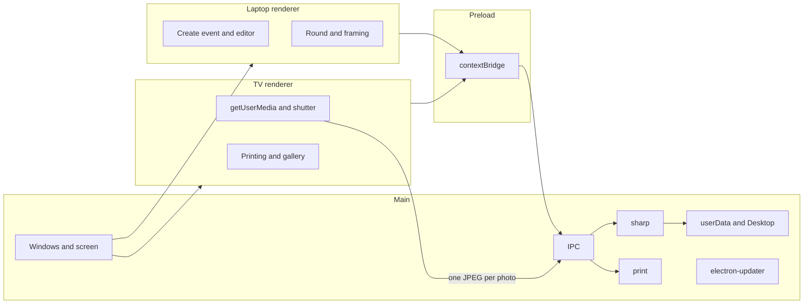
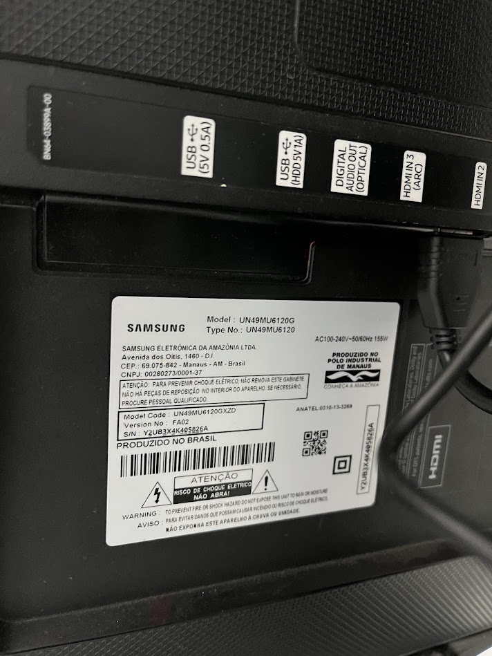

# Foto Mágica 2.0 — Technical and visual design

> How the app is built. What it does is in [PRD.md](./PRD.md). If the two disagree, the PRD wins and this file changes in the same PR.
>
> **Language note.** This document is written in English. End-user UI strings (labels, messages, empty states) stay in pt-BR and are quoted verbatim.

The folder layout follows [PilatePay](https://github.com/ovinidev/PilatePay), read on 2026-11-14 (`src/app`, `src/features/<name>`, `src/shared`, `e2e/`, `docs/PRD.md`, `docs/DESIGN.md`). PilatePay is a PWA with Supabase. Here there is no backend: Electron's main process takes the place of the server, and the renderer repeats the feature-based core. Its linter is ESLint; this repo's is oxlint.

## 1. Stack

| Area | Choice |
| --- | --- |
| Shell | Electron, two `BrowserWindow`s |
| UI | React + strict TypeScript |
| Bundle | electron-vite (main, preload, renderer) |
| Laptop | Tailwind CSS + shadcn/ui, Inter bundled with `@fontsource/inter` |
| TV | Own surface in `features/camera`, frosted glass, no form skin |
| Validation | Zod at the edge of every IPC channel and when reading local JSON |
| Image | `sharp`, isolated in `src/main/compose/` |
| Printing | Module `src/main/print/`, with a Windows implementation and a simulated implementation |
| Update | electron-updater, GitHub provider |
| Installer | electron-builder, NSIS target, on GitHub Actions |
| Tests | Vitest + Testing Library; Playwright with `_electron.launch` |
| Lint | oxlint (`.oxlintrc.json`). No ESLint |
| Packages | pnpm, Node `>= 22` |

## 2. Processes



- `nodeIntegration` off, `contextIsolation` on, `sandbox` on in both windows
- The renderer imports neither `electron` nor `fs`. Everything goes through the single object exposed by the preload
- The live preview does not cross the main process: the laptop frame travels over a `MessageChannel` between the two windows. Only the photo, at the shutter, goes to main as a JPEG `Uint8Array`
- Main is the source of truth for the round. Both renderers receive the same state

## 3. Windows and the TV monitor

`src/shared/displays.ts` exports a pure function. `src/main/windows/` only reads `screen.getAllDisplays()` and hands over the list:

```ts
type DisplayInfo = {
  id: number
  primary: boolean
  x: number
  y: number
  width: number
  height: number
}

type GuestChoice =
  | { kind: 'portrait'; display: DisplayInfo }
  | { kind: 'landscape-external'; display: DisplayInfo }
  | { kind: 'missing' }
```

The choice, in order:

1. Among the monitors that are not the primary, the portrait one (`height > width`) whose aspect ratio is closest to 9:16
2. If there is only a landscape external, `landscape-external`
3. If there is only the primary, `missing`

The module that reads `screen.getAllDisplays()` is thin and hands `DisplayInfo[]` to this function. The unit test covers the three outputs without Electron. With `FOTOMAGICA_E2E=1`, the list comes from a fixture: primary 1920×1080 and a secondary 1080×1920. This way E2E does not depend on two physical monitors. `FOTOMAGICA_DISPLAYS` picks another fixture (`portrait-tv`, the default, `landscape-tv` or `laptop-only`), and under E2E main exposes a test hook that swaps the fixture at runtime to simulate plugging and unplugging the TV.

Monitors change at runtime (`display-added`, `display-removed`, `display-metrics-changed`). A second pure function, `placeGuestWindow`, decides what the open TV window does, and `src/main/windows/guestWindowController.ts` applies it:

- The window stays on its current monitor while that monitor is still an eligible TV, so another screen plugged in mid-party does not steal it. A monitor event that leaves the TV unchanged does not touch the window
- If the TV goes away (or turns landscape without confirmation), the window is hidden, never moved onto the laptop screen and never destroyed: the camera and the round stay in memory. The laptop shows that the TV was disconnected
- When an eligible TV comes back, the window covers it again on its own
- The landscape confirmation (RF04) lasts until the TV window is closed

`event:start` opens the TV window through this controller and `event:end` closes it; there is no separate IPC to open the TV, so the TV never shows without an event. The create-event form shows the TV state and, for a landscape TV, a checkbox the operator ticks to open anyway (RF04). The TV window closing for any reason ends the event.

The operator window opens on the primary monitor, with a frame and a comfortable size (minimum 1280×800). The TV window has no frame, ignores accidental close and covers the `bounds` of the chosen monitor. Main closes it, on `Encerrar evento` or when quitting the app.

The reference TV is 1080×1920. If Windows reports another portrait height (for example 2160×3840 at different DIPs), the TV UI scales from a logical frame of 1080×1920 to keep the same 64 px targets proportional to the screen. The computation of that scale is a pure function, with a test.

Samsung UN49MU6120, equipment label:



## 4. IPC

The preload exposes `window.fotomagica`. Each method validates input and output with Zod. Channel names and schemas live in `src/shared/ipc/`, with no React and no Electron, imported by main, preload and renderer. The renderer only calls the typed object.

| Direction | Channel | Role |
| --- | --- | --- |
| invoke | `template:get-all` | Each mode's stored template (name, size and a small JPEG preview), or `null` |
| invoke | `template:import` | Mode, file name and bytes. Stores a 1844×1240 PNG or JPEG for that mode only, or returns `format`, `size` (with the size read) or `unreadable` |
| invoke | `event:start` | Name, mode (`two-strips` or `one-strip`) and the landscape confirmation. Checks the name and that mode's stored template, opens the TV, then creates or reuses the Desktop folder. Returns the session or the reason (`invalid-name`, `no-template`, `missing`, `landscape`, `folder-failed`, `already-open`) |
| invoke | `event:end` | Closes the TV and forgets the unprinted round |
| invoke | `session:get-state` | The event and its round (`idle`, or name, mode, timer, copies, photos taken, preview revision, slots and phase) |
| invoke | `session:get-preview` | The current montage preview JPEG and its revision |
| invoke | `session:set-timer` / `session:set-copies` | Timer (0, 5, 10) and copies (1 to 10), shared by both windows |
| invoke | `session:new-round` | `Nova rodada`, after a print |
| invoke | `layout:get` / `layout:save` | Reads both layouts (five slots in `two-strips`, three in `one-strip`) and writes one mode's layout. `layout:save` returns both layouts, or `event-open` (refused while an event runs) or `failed` |
| send | `session:request-shutter` | The laptop requests the capture. Main forwards it to the TV |
| send | `session:photo` | The TV delivers the already rotated and mirrored JPEG |
| invoke | `session:set-framing` | Pan, zoom and rotation of one slot of the round |
| invoke | `session:cancel` | Discards the round |
| invoke | `session:print` | No input: the copies live in the session. Composes, saves, prints; after a failed send, resends the file already saved |
| invoke | `session:reprint` | `Imprimir novamente`: resends the round's JPG with the current copies |
| invoke | `gallery:list` | The open event folder's montages (only `HH-mm-ss.jpg` names the app writes), newest first. Names only, never a path |
| invoke | `gallery:get` | One montage by name, as the file (`full`) or a 480 px JPEG (`thumb`); `null` when it is gone |
| invoke | `gallery:reprint` | `Imprimir novamente` from the gallery menu: resends that file, one copy, in the event's mode. No new file |
| invoke | `webcam:get` / `webcam:set` | Saved values, the controls the camera last advertised, and `live` (the TV has the camera open). `set` saves and pushes `webcam:state` |
| send | `webcam:report` | TV → main: the open camera's capabilities, or `null` with no camera. Ignored from other windows |
| event | `webcam:state` | Main → both windows, on every change of the adjustments |
| event | `gallery:changed` | Main → both windows, after a montage is written |
| invoke | `printer:status` | A fresh read of the printer state (`PrinterStatus`, §10) |
| event | `session:state` | Main → both windows, on every round change |
| event | `printer:status-changed` | Main → laptop and TV, when the polled state changes |
| invoke | `display:get-state` | TV monitor choice (`GuestChoice`) and TV window state (`closed`, `open` on a monitor, or `detached` because the TV went away) |
| event | `display:state` | Main → both windows, on every monitor change and every TV window change |
| send | `camera:report` | TV → main, the state of its `MediaStream`. Main ignores it from any other window |
| invoke | `camera:get-status` | Last camera state reported by the TV (`idle` while the TV window is closed) |
| event | `camera:status` | Main → both windows, on every camera state change |
| send | `camera:request-preview-port` | Either window, on mount: main creates a `MessageChannelMain` and posts one end to each window on `camera:preview-port` |
| event | `session:shutter` | Main → TV only, when the laptop asked for a photo |

`camera:preview-port` carries no payload, only the transferred port, so it is not in the Zod contract. `contextBridge` cannot pass a `MessagePort`: the preload re-posts it to the page with `window.postMessage` and the page recognizes the fixed message `PREVIEW_PORT_MESSAGE`. Binary payloads (captures, previews, templates) are checked as `Uint8Array` by tag, not `instanceof`, because the preload's isolated world has its own globals, and each has a size ceiling.

Every `send` and `event` payload has a Zod schema too: the preload validates before sending and before calling a listener, main validates on arrival and before broadcasting.

The TV is the sole owner of the `MediaStream`. The laptop's shutter does not capture on its own: it asks main, and main tells the TV to run the same path (timer included).

## 5. Capture

The MX Brio is mounted horizontally, on top of the TV. The sensor delivers landscape. Software stands the person upright, like the 90° rotation of Webcam Photobooth. There is no physical rotation of the camera.

Fixed order, a single function, used by the preview and by the file:

1. Raw frame, ideally 1920×1080, 30 fps, no audio
2. Rotation to portrait. The angle lives in `CAMERA_ROTATION_DEG`, initial value `90`, in a single file. Flipping the sign of this constant turns the image over if the first test on the hardware shows the person upside down
3. Horizontal mirroring

`getUserMedia` asks for ideal `width` and `height` of 1920 and 1080 (the webcam is not used at 4K in practice). These are ideals, not requirements: whatever mode the camera delivers is accepted. The preferred device is the one whose label contains `MX Brio`. Without it, the first `videoinput`. With more than one camera and no Brio, create-event shows a select. Labels are empty before the camera permission exists: the camera is then opened blind, the list is read again and, if the Brio shows up, it replaces the one opened.

Only the TV window gets the camera permission, video only; every other permission request is denied. The geometry lives in `src/shared/capture/orientation.ts` (`frameTransform`), the only drawing call in `features/camera/utils/drawFrame.ts`: the preview passes its canvas size (cover fit), the still passes nothing (full resolution). Both go through the same matrix.

Camera states on the TV, floating on glass over the black surface, reported to the laptop:

| State | Message |
| --- | --- |
| opening | Abrindo a câmera… |
| permission denied | Sem permissão para usar a câmera |
| no camera | Nenhuma câmera encontrada |
| in use by another program | A câmera está em uso por outro programa |
| unplugged | A câmera foi desconectada |
| other | Não foi possível abrir a câmera |

The error states offer `Tentar novamente` (64 px target). A device plugged in while in error reopens the camera on its own. Under E2E, Chromium's fake device replaces the webcam: its moving pattern by default, a `.y4m` file with `FOTOMAGICA_FAKE_CAMERA=<path>`, or no camera at all with `FOTOMAGICA_FAKE_CAMERA=none`.

The TV preview draws this frame on a canvas, with `requestAnimationFrame`. The camera opens once, on the TV. At the start of the event main hands a `MessageChannel` to both windows. At most 30 times per second the TV transfers an `ImageBitmap`, already rotated and mirrored through the same `drawCameraFrame`, at `LAPTOP_PREVIEW` (360×640), and drops the frame until the laptop answers `ack` for the previous one. Either window asks for a fresh channel when it mounts, so a reload on either side reconnects. This does not go through `invoke` and does not write to disk. The full-resolution JPEG remains a single send, at the shutter.

At the shutter the TV waits (up to 3 s) for a decoded video frame, so a tap right after the camera opens still takes the photo, then exports a quality-95 JPEG of the already transformed frame (portrait, mirrored) and sends the bytes. Main keeps the three captures in the round. It does not write those three to disk.

### Constraints

The panel reads `track.getCapabilities()` and only draws what exists:

| Control | Constraint |
| --- | --- |
| Brightness | `brightness` |
| Contrast | `contrast` |
| Saturation | `saturation` |
| Sharpness | `sharpness` |
| White balance | `whiteBalanceMode` and, in manual, `colorTemperature` |
| Gain | `gain`, or whatever name the capability uses for the gain in figure 8 |
| Backlight | `backlightCompensation`, only if it exists |

`applyConstraints` runs on the TV. The saved value goes along in `webcam:set`. When the event opens, the TV reapplies the JSON. `powerLineFrequency`, if it exists, is fixed at 60, with no control on screen.

The pure rules are in `src/shared/webcam.ts`: `readWebcamCapabilities` keeps only the controls above that have a usable `{ min, max }` range (gain is `gain`, else `iso`), and `webcamConstraintSet` clamps each saved value to its range and step, under the capability's own name, as one `advanced` set. Color temperature only applies, and is only drawn, in manual white balance. The TV reports what its track advertises with `webcam:report`; main stores those controls in `config.json` next to the values, so the panel still opens with the saved controls when there is no camera (RF15 fixture mode), with the note `A câmera não está aberta. Os ajustes ficam salvos e são aplicados quando ela abrir.` A camera that advertises no control at all (Chromium's fake device) does not erase the controls saved from the real one. The panel saves 200 ms after a slider rests, so a drag is one write.

The numbers visible in figure 8 (brightness 145, contrast 111, and the rest) are the state of that Windows on the day of the photo. The app does not copy them as factory defaults: it shows what the camera reports and persists what the operator changes.

## 6. Montage

The logical sheet is 1844×1240 px, 300 DPI. It is the "print extent" of the current app. The 1800×1200 that also appears in the dialog is the inner area: 1844 − 22 − 22 and 1240 − 20 − 20.


The geometry is pure and unit-tested without sharp; the sharp shell is tested with real images (the golden test below).

For each slot, in this order:

1. The capture of the indicated photo (1, 2 or 3), already upright and mirrored
2. Pre-rotation of the photo by minus the quarter turn nearest to the slot's `angle` (Angle 270 turns the photo 90° clockwise first). Step 4 turns it back, so the person stays upright while the slot's frame turns: a 500×281 slot at Angle 270 shows a tall, upright portrait
3. `cover` fit into the unrotated rectangle (`width` × `height`), with that slot's pan (-1 to 1 on each axis) and zoom (1 to 3). Zoom 1 and pan 0 crop the center: in a horizontal slot, the portrait loses top and bottom in equal parts. With a framing rotation, the photo covers the bounds of the box turned by that rotation (plus 2 px), is turned clockwise by it, and the centered `width` × `height` is kept, so no corner of the slot ever shows the template (RF09)
4. Rotation of the result by the slot's `angle`, clockwise around the center
5. Composition over that mode's template, centered on the slot's center and clipped to the sheet. A slot dragged partly off the sheet is cut there (the client seed sits fully inside)

The plan is pure (`planSlot`, `clipToSheet` in `src/shared/layout/geometry.ts`) and `src/main/compose/renderSheet.ts` runs it with sharp, one materialized step at a time (sharp otherwise reorders rotate, resize and extract). The preview the laptop and the TV show is the same composition scaled to 922 px wide, recomposed after each photo; the round state carries a `previewRevision` and both windows fetch the JPEG with `session:get-preview`.

The chosen mode only changes which layout and which template are used. Both fill the 1844×1240. The 1 tira mode does not paint half of it white.

The golden test does not depend on guessing the pivot: a frame with a light bar at the top must show that bar at the top of each slot. In 2 tiras mode, the top three are vertical and the bottom two horizontal. In 1 tira mode, the three seed slots are vertical and the sheet has no empty half. If an angle of 270 lays the person down, the sign of the slot rotation is wrong and the test fails.

After the mode's slots, `sharp` writes a quality-95 JPEG, density 300, 1844×1240. This is the `HH-mm-ss.jpg` file.

The cut line used by the editor, only in the 2-strip layout, is y = 620. It falls in the 576–733 gap of the client's 2 tiras artwork and is to be confirmed on a test sheet. A slot that crosses this line does not prevent saving, and the editor shows a warning. The 1-strip layout does not draw this line.

### Editor model

Left and Top are the top-left corner of the rectangle before rotation. Width and Height do not swap when the angle changes. Rotation is around the center. The panel shows these numbers as integers.

In the current app, Angle 270 with 500×281 draws a tall slot, and Angle 0 draws a lying-down slot. The new renderer reproduces this. The photo number is drawn in the slot's local space, so it rotates with it, as in the demonstration: vertically the "3" is sideways. This is the current app's behavior, and the editor keeps it.

A slot's `photo` is 1, 2, 3 or `null` (`Nenhuma` in the panel). The montage skips a `null` slot, so the template shows there.


## 7. Fluid editor and snap

The editor has a mode selector. `two-strips` shows the five slots and the cut line. `one-strip` shows the three. The gestures below apply to both. Webcam Photobooth's freezing comes from redoing the whole layout, or from talking to the process, on every mouse move. The new editor handles the gesture like this:

- `pointerdown` on the slot or the handle stores the origin
- `pointermove` updates a ref and writes directly to the DOM transform and to the `value` of the Left, Top, Angle, Width and Height fields, in the same frame (`paintSlot` in `features/layout/utils/livePaint.ts`). Typing in a number field moves the card through the same path; Enter or blur commits
- There is no `invoke` and no disk write while the button is held
- `pointerup` commits the React state and calls `layout:save` once, writing only the layout that is on screen (`two-strips` or `one-strip`)

Handles: northwest, north, northeast, east, southeast, south, southwest, west, at the corners and at the midpoints of the edges of the already rotated rectangle. The rotation handle sits outside the middle of the bottom edge, connected to the center by a dashed rod. In the current editor's video, with the slot upright, this rod points down and the number rotates with the slot.

Snap is pure, in `src/shared/layout/snap.ts`: `snapMove(draft, others, { mode, alt })`, `snapResize(draft, handle, others, { mode, alt })` and `snapAngle(angle, { alt })`, each returning the draft to show. The gesture math (move, resize from a handle read in the slot's rotated axes with the opposite edge fixed, rotation from the handle) is in `gesture.ts`. Targets:

| Target | Where |
| --- | --- |
| Sheet | x = 0 and 1844, y = 0 and 1240, center x = 922, y = 620 |
| Print margin | x = 22 and 1822, y = 20 and 1220 |
| Cut | y = 620, only in the 2-strip layout |
| Other slots | edges and center of the already rotated rectangle |

The slot's edges (of its rotated bounds) snap to edge targets: sheet edges, margins, the cut line and the other slots' edges. Its center snaps to center targets: the sheet center and the other slots' centers. That is why, in 1 tira, a slot edge at y = 620 does not snap (the cut line is not a target there) while a slot centered on the sheet still does. A resize snaps only the dragged edges, and only when the angle is a quarter turn; a tilted slot resizes freely.

The tolerance is 8 px in sheet space, not screen pixels. Rotation also snaps to 0, 90, 180 and 270 within 4°. Alt held returns the draft unchanged. The unit test covers snapping, not snapping and Alt.

Minimum slot size: 40×40 px, so the handle does not invert the rectangle.

Every commit (a released gesture, a confirmed number, a photo choice, `Restaurar padrão`, Undo, Redo) is one history step of the layout on screen and one `layout:save`. The history lives in the editor only (up to 100 steps) and is not saved. The operator window has no menu (`removeMenu`): with Electron's default menu, releasing Alt would reveal the menu bar and shift the editor in the middle of a gesture.

The editor is a full-window dialog over the home page (the form underneath keeps its state). It opens after a template is accepted and from `Editar posições das fotos`. With an event open the home page is not rendered, so the editor is unreachable; main also refuses `layout:save` while the session is open.

## 8. Round framing

This is not the slot editor. With the party open, the slot stays still. The gesture on the laptop preview moves the photo inside it: dragging moves, the wheel zooms, a small handle (ink color, not the editor's red) rotates the photo. Each slot of the round has its own pan, zoom and rotation, including when two slots use the same capture.

Next to it, the laptop shows the camera without the iPhone chrome, in the full portrait. The guide is the part of the frame that every slot of the next photo keeps at default framing (`guideCrop`): for photos 1 and 2 of 2 tiras, the horizontal band of the bottom strip; for photo 3 of 2 tiras, its vertical slot; in 1 tira mode, the portrait slot of the next photo.

Framing is `{ zoom 1..3, panX -1..1, panY -1..1, rotation -180..180 }` per slot id, kept in the round (`framings` in `session:state`, absent means the default) and sent with `session:set-framing`. Main accepts it only for a slot whose photo is taken and only until the montage is written (capturing, review, or a failed save); `Nova rodada` and `Cancelar` reset it. The gesture math is pure, in `src/shared/layout/framing.ts`: a drag is read in the photo's own axes (slot angle plus framing rotation) and turned into pan using the 1920×1080 capture stood upright as the assumed photo size, so the photo follows the pointer; the wheel zooms by `exp(-deltaY / 500)`; the handle turns by the angle swept around the slot center and snaps to 0° within 3° (Alt turns that off). The laptop also offers `Aproximar`, `Afastar`, `Girar para a esquerda`, `Girar para a direita` (5° steps) and `Restaurar enquadramento`.

Unlike the slot editor, framing does go to main during the gesture, because the TV print preview must follow it: the laptop keeps at most one `session:set-framing` in flight and only the latest framing waits, and main composes one preview for a burst (a queued preview job reads the round when it starts). Nothing is written to disk until `Imprimir`.

## 9. Persistence

| Data | Location |
| --- | --- |
| Both layouts, both templates, webcam values and the controls the camera last advertised | `app.getPath('userData')/config.json` |
| Each mode's template file (`two-strips.png` or `.jpg`, `one-strip.…`) | `app.getPath('userData')/templates/` |
| JPG montage | `app.getPath('desktop')/<event name>/HH-mm-ss.jpg` |

The folder name goes through a pure function: trim, reject empty, reject the characters `\ / : * ? " < > |`, reject reserved Windows names, reject a trailing dot or space. The test lists these cases.

File time: local time, 24 h, `HH-mm-ss.jpg`. A collision in the same second appends `-2`, `-3`, a pure function over the list of existing names.

The round (three JPEGs and the framings) lives in main's memory. There is no draft. Closing the process before `Imprimir` loses the round.

The JSON is read with Zod. A missing or invalid file falls back to the two PRD seeds and an empty webcam, without breaking startup. An invalid layout does not erase the other.

## 10. Printing

Only `src/main/print/` knows the driver, dialog or simulation. React asks for `printer:status` and `session:print`.

```ts
type PrintMode = 'two-strips' | 'one-strip'

type PrinterStatus =
  | { kind: 'ready' }
  | { kind: 'offline' }        // powered off, unplugged, or "use printer offline"
  | { kind: 'no-paper' }
  | { kind: 'no-ribbon' }
  | { kind: 'paused' }         // the Windows queue paused by hand
  | { kind: 'error'; detail: string }   // jam, door open, generic error flag…
  | { kind: 'not-found' }      // no queue whose name contains DS-RX1
  | { kind: 'unknown'; detail: string } // the state could not be read

type PrintTicket = {
  jpegPath: string
  copies: number
  mode: PrintMode
  cut: boolean
}

type PrintResult =
  | { ok: true }
  | {
      ok: false
      reason: 'offline' | 'no-paper' | 'no-ribbon' | 'paused' | 'printer-error' | 'not-found'
        | 'cut-unavailable' | 'unreported' | 'failed'
      detail: string
    }
```

`PrinterStatus` lives in `src/shared/ipc/schemas.ts`, because `printer:status` carries it. The session adds `save-failed` (the JPG could not be written) to the failure reasons in the round phase.

Two implementations of the same interface:

- `SimulatedPrinter`, used with `FOTOMAGICA_PRINTER=simulated`. Copies the JPEG to `userData/simulated-prints/` and writes the ticket as JSON. `FOTOMAGICA_PRINTER_STATUS` forces `ready`, `offline`, `no-paper` or `no-ribbon`. `FOTOMAGICA_PRINTER_CUT=unsupported` returns `cut-unavailable`. Under E2E, the test hook `__fotomagicaE2E.setPrinter` changes both at runtime, so a spec can put the paper back and tap `Tentar novamente`
- `WindowsDnpPrinter`, the only one that talks to the spooler, described below

### The Windows printer

Real printing is silent, with no Windows dialog and no "printing page" window. Paper 6.00" × 4.00" (152 × 102 mm), 300 DPI, Portrait orientation, same as figure 10. The bitmap is not rotated again.

The 2" cut is the flag the driver shows as `2inch cut`: `Disable` or `Enable (Printer V.1.10 or later)`. It is a private driver setting, not a standard DEVMODE field. That rules out Electron's `webContents.print({ silent: true, deviceName })`: it can choose the queue, the paper and the orientation, but not a private driver option. The app therefore prints through the Windows **Print Schema**, where the driver publishes every option, private ones included:

1. Main keeps one **Windows PowerShell 5.1** process alive (`src/main/print/dnp/dnp-helper.ps1`, bundled with Vite `?raw`, written to `userData/helpers/` at the first request and started with `-EncodedCommand`, which the execution policy does not block). PowerShell 5.1 and .NET Framework's `System.Printing` ship with Windows 10 and 11: nothing is installed, nothing needs the network, nothing is compiled at runtime. Requests and answers are one JSON line each (`dnp/protocol.ts`), in ASCII, so an accented event folder survives any console code page. A request that times out kills the helper; the next one starts a new one
2. `list`: every local queue with its `PRINTER_STATUS` bits and the "use printer offline" switch. Main picks the first queue whose name contains `DS-RX1` (`dnp/spooler.ts`)
3. `capabilities`: the queue's PrintCapabilities as features and options. Main chooses, in tested TypeScript (`dnp/capabilities.ts`): the cut feature (named like `2inch cut`, or else the single private feature mentioning "cut"), its `Enable…` or `Disable` option, the `PageMediaSize` option within 5 mm of 6×4 (by size, not name), `psk:Portrait`, and the 300×300 `PageResolution` option when the driver names one. Cached until a print fails
4. `print`: the helper merges those options into the queue's user ticket with `MergeAndValidatePrintTicket`, then reads back the validated ticket. If the driver changed the cut, the paper or the orientation while resolving conflicts, nothing is spooled and the answer says which. Otherwise it converts the ticket to the driver's DEVMODE (`PrintTicketConverter`, private part included) and prints the JPG with `System.Drawing.Printing`: `StandardPrintController`, one page per copy in a single job, the image covering the page from the physical corner. If the page the driver gives is the other way round from the 1844×1240 bitmap, it stops instead of rotating or stretching

- In `two-strips` main requests `Enable` and composes the five slots over that mode's template. If the driver does not offer or does not keep the cut on, the result is `cut-unavailable` and the UI does not treat the sheet as printed.
- In `one-strip` main requests `Disable` and composes the three slots over that mode's template, filling the 1844×1240 sheet. There is no blank half and no 6×2 paper. If the driver does not offer or does not keep the cut off, the result is also `cut-unavailable`: the sheet must not come out cut by mistake.


Before spooling, main reads the status. Offline, no paper, no ribbon, paused, an error flag or no DS-RX1 queue stop the print with that reason, so the sheet does not sit in the Windows queue. `unknown` goes ahead. If spooling fails, main reads the status again: a flag that now explains it becomes the reason, and no flag becomes `unreported` ("the driver did not report"). The driver's own words travel as `detail`, shown on the laptop as `Detalhe técnico: …` and never on the TV.

Limits, which the owner checks on the device:

- "Printed" means the job was accepted by the spooler. The app does not follow the job to the end of the sheet. A sheet that fails after spooling shows in the printer line (polled) and is fixed with `Imprimir novamente`
- Paper and ribbon only show if the DS-RX1 driver sets the spooler flags. `NO_TONER` is read as out of ribbon, because it is the spooler's only consumable flag. If the driver sets none of them, the line says `Impressora pronta` while the spooler reports no error; the PRD's "the driver did not report" applies when a print fails with no flag
- The cut is found by its name in the driver. A driver version that names it differently, or exposes two cut settings, gives `cut-unavailable` rather than a guess

Status, from the spooler, polled every 5 s (every 250 ms for the simulation) and after every print, pushed with `printer:status-changed`:

| State | Spooler | Message |
| --- | --- | --- |
| offline / powered off | `OFFLINE`, `NOT_AVAILABLE`, work offline | Impressora desligada |
| out of paper | `PAPER_OUT` | Impressora sem papel |
| out of ribbon | `NO_TONER` | Impressora sem ribbon |
| queue paused | `PAUSED` | A fila da impressora está pausada no Windows |
| other error | `PAPER_JAM`, `DOOR_OPEN`, `ERROR`… | A impressora informou um erro |
| no DS-RX1 queue | | Impressora DS-RX1 não encontrada |
| could not read / spooler unknown | `SERVER_UNKNOWN`, helper failure | O driver não informou papel nem ribbon |
| no flag | | Impressora pronta |

A failed send with no flag reads `Não foi possível imprimir. O driver não informou papel nem ribbon`. The laptop shows the printer line during the event. The TV print screen shows the state above its buttons when the printer is not ready, before anyone taps `Imprimir`.

Other options visible in the driver (border, glossy overcoat, print re-try, page layout) are not changed by this app.

Order of `Imprimir`: compose, write the JPG to the event folder, then send. If sending fails, the file stays and the round remains on the print screen with `Tentar novamente`, which resends that same file. If the write fails, there is no printing and the screen does not announce success.

Copies: the ticket carries 1 to 10, a ceiling approved by the owner. Each copy is one 6×4 sheet. In `two-strips` the blade splits the sheet. In `one-strip` the sheet comes out whole, with the three photos.

## 11. Update and signing

electron-updater with the GitHub provider, on the repository `ovinidev/PhotoMagic`. The check runs at startup, only with no event in progress. A network failure is ignored: the app opens. The download does not occupy the TV. Installation happens on quit, when a new version has already been downloaded.

The published installer is named `FotoMagica-Setup.exe`, for the stable address:

`https://github.com/ovinidev/PhotoMagic/releases/latest/download/FotoMagica-Setup.exe`

Signing, in the Windows job, only applies if the secrets are filled in:

- `CSC_LINK`: `.pfx` certificate in base64
- `CSC_KEY_PASSWORD`

`CSC_IDENTITY_AUTO_DISCOVERY` stays `false`. The step exports `CSC_LINK` and `CSC_KEY_PASSWORD` only when the secret is non-empty. Without them electron-builder produces the installer unsigned and the job ends green. The workflow does not store the certificate in the repository.

NSIS: per machine, desktop shortcut, selectable install directory. `appId`: `com.fotomagica.desktop`. `productName`: `Foto Mágica`.

Builder icon: `assets/brand/icon.ico`, generated from `assets/brand/icon.png` (symbol on a light background) by `pnpm icon` (`scripts/build-icon.mjs`, sharp) with PNG entries at 16, 32, 48 and 256; a unit test checks the four sizes. The operator window uses `icon.png` as its window icon (title bar and taskbar in dev); the installed exe carries the `.ico`. The TV window has no taskbar entry. The full logo does not go into the small icon, because the text does not survive at 16 px.

## 12. CI and tests

Two workflows implement this contract. `.github/workflows/ci.yml` runs the checks on pull requests and on pushes to any branch except `main`; it is also a reusable workflow. `.github/workflows/release.yml` runs on push to `main`: it calls `ci.yml` and then the Windows job below.

**On every pull request and every push**

- Node 22, pnpm with a frozen lockfile
- `pnpm typecheck`
- `pnpm lint` (`oxlint --deny-warnings .`)
- `pnpm test:coverage`
- `pnpm exec playwright install --with-deps chromium` when the runner is Linux
- `pnpm test:e2e` with `FOTOMAGICA_E2E=1` and `FOTOMAGICA_PRINTER=simulated`, under `xvfb-run`. Playwright's global setup runs `electron-vite build` first. Each test gets its own `FOTOMAGICA_USER_DATA` and `FOTOMAGICA_DESKTOP` folders (read only under E2E), so E2E never touches the real `userData` or Desktop. `FOTOMAGICA_PRINTER_STATUS` and `FOTOMAGICA_PRINTER_CUT` drive the simulated printer's failures. A full-resolution capture takes 3–4 s under xvfb, so the round specs allow 15 s per photo

The pull-request E2E can run on `ubuntu-latest`: the printer is simulated, the camera is a fixture and the second monitor is injected. What is Windows-specific (DEVMODE, signing, NSIS) stays in the packaging job. The PowerShell helper is not run in CI; it is checked on the DS-RX1 by the owner.

**On push to `main`, an extra job on `windows-latest`**

- `pnpm dist` (electron-builder `--win`)
- Publishes a GitHub Release `v<version>` (installer, blockmap and `latest.yml`, not a draft) when `package.json` `version` does not yet exist as a release
- Signs only with the secrets present, as in section 11

A push that does not bump the version produces the installer as a workflow artifact and does not create another release. electron-updater only sees a published release.

### What the tests cover

Pure rules, next to the file, in Vitest:

- monitor choice and runtime placement of the TV window
- camera rotation, mirror and cover fit; preview and still through the same transform
- camera device choice and constraints
- snap, including Alt and angle snap
- folder name and `HH-mm-ss` name
- template size
- `cover` fit with a bar at the top (RF08)
- ticket mapping: `two-strips` requests cut on, `one-strip` requests cut off and composes three slots over the whole sheet
- DS-RX1 queue choice, spooler flags to printer status, the cut / 6×4 / Portrait / 300 DPI choice from PrintCapabilities, the helper line protocol and process bridge, and `WindowsDnpPrinter` against a fake helper (refusals before spooling, cut changed by the driver, spool error with and without a flag)

E2E, in `e2e/`, one spec per flow, on real Electron:

| Spec | Flow |
| --- | --- |
| `create-event.spec.ts` | Name, correct and wrong template, folder |
| `layout-editor.spec.ts` | Editor after import with the five cards, drag with live panel and one write on release, snap and Alt, rotation and resize, numeric edit, the two independent layouts across a relaunch, and the event using its layout |
| `capture-round.spec.ts` | Three photos, counter, timer, cancel, framing one slot on the laptop with the TV preview following |
| `print.spec.ts` | Simulated ticket, copies, status failure, printer line and TV warning, `Tentar novamente` after the paper or the cut is fixed, single file |
| `gallery.spec.ts` | Only the app's montages listed on the TV and the laptop, a new print showing up, fullscreen, reprint from the menu with no new file |
| `resilience.spec.ts` | Webcam disappears mid-round (the spec ends the fake track and then fires `devicechange`), TV keeps responding, the missing photo after reconnecting; TV unplug and replug; no camera; webcam panel with persisted controls in fixture mode and across a restart; ending closes the TV |

A PRD scenario whose screen does not exist yet stays as `test.fixme`, with the requirement id in the title, and becomes a test in the PR that builds the screen. E2E does not point at the DS-RX1 or the MX Brio.

The project uses Husky with a `pre-push` hook that runs oxlint, typecheck, unit tests (`pnpm test`) and Playwright (`pnpm test:e2e`). It lives in `.husky/pre-push`, in the same role as the hook in PilatePay; on Linux without `DISPLAY` or `WAYLAND_DISPLAY` it runs Playwright under `xvfb-run`. While iterating, run only the files or specs you touched, with summarized output (see CLAUDE.md); do not run the full suite yourself. Tail only failures; never paste long test or build logs.

oxlint, minimal configuration: plugins `react`, `typescript` and `import`; category `correctness` as error; React hooks rule as error; ignore `dist`, `out`, `release`, `coverage`, `playwright-report`. `no-restricted-imports` enforces the folder rules of §13: no feature internals across features, no Electron or Node in the renderer, no React or Electron in `src/shared`, and `renderer/shared` never imports a feature or `app`. No ESLint file alongside.

## 13. Folders

```
src/
  shared/                no React and no Electron
    ipc/                 channel names, Zod schemas and the invoke contract
    layout/              modes, seeds, slot geometry, editor gestures and snap
    capture/             rotation, mirror, cover
    files/               folder name and HH-mm-ss
    round.ts             timer options and copies
    template.ts          template format and size check
    displays.ts          TV monitor choice
    constants.ts         rotation, sheet, margins, copies, TV frame
    runtime.ts           FOTOMAGICA_* environment flags
  main/
    index.ts
    windows/             reads screen and calls the pure displays function
    ipc/                 handlers, one module per area
    session/             round state
    compose/             sharp shell around renderSheet
    print/               types.ts, SimulatedPrinter.ts, WindowsDnpPrinter.ts, monitor.ts
      dnp/               spooler flags, PrintCapabilities choice, helper protocol and bridge, dnp-helper.ps1
    persist/             config.json and the per-mode templates
    updater/
    gallery/             the event folder's montages by name, thumbnails
  preload/
    index.ts             contextBridge
    fotomagica.d.ts      window.fotomagica type for the renderer
  renderer/
    operator.html
    guest.html
    app/                 laptop routes and TV shell
    features/
      events/            create event, name, mode template, 2 tiras or 1 tira
      layout/            editor and handles
      session/           laptop event screen: live preview and guide, montage preview, round controls
      camera/            TV: live view, shutter, timer, laptop preview sender; laptop TV and camera status
      print/             TV print screen, printer status line and hook
      gallery/           TV thumbnail and grid, laptop panel, fullscreen view and reprint menu
      webcam/            constraints panel (TV and laptop), applying the saved values on the TV track
    shared/
      components/ui/     shadcn, used by the laptop
      hooks/             session state, montage preview, object URL
      utils/             cn, TV glass, preview-port hand-off
    test/                Vitest setup for renderer tests
e2e/
docs/
  PRD.md
  DESIGN.md
  assets/briefing/       figures image1.png … image13.png
assets/brand/
  logo.png               transparent lockup
  mark.png               transparent symbol, 1024
  icon.png               symbol on a light background, source of the .ico
  icon.ico               16, 32, 48 and 256, generated by `pnpm icon`
scripts/
  build-icon.mjs         icon.png → icon.ico
```

Rules, the same as PilatePay:

- A feature imports `shared/` and another feature's `index.ts`
- `shared/` does not import a feature or `app/`
- Only the subfolders the feature uses are created (`components/`, `hooks/`, `utils/`, `pages/`)
- The home screen is not a feature: it is a page in `app/` that composes `events` and `layout`
- Main imports types and pure functions from `src/shared/`, never a component
- Alias `@shared` points to `src/shared`. Alias `@brand` points to `assets/brand`, from where the UI imports `logo.png`. Alias `@renderer` points to `src/renderer` and is only used inside the renderer

There is no `supabase/`, no `vercel.json` and no API client. There is no TanStack Query: PilatePay's server state is, here, IPC.

## 14. Visual design

Two surfaces. The laptop is light paper. The TV is the iPhone camera, dark and translucent, over the image. The light-mode requirement applies to the laptop. The TV is not a light form, because the reference in figure 7 is the camera.

### Tokens

They live in `src/renderer/index.css`, as variables, and Tailwind 4 reads them in `@theme`.

| Token | Value | Use |
| --- | --- | --- |
| `--bg` | `#F4F1EB` | Laptop background |
| `--bg-raised` | `#FBF9F6` | Card, panel, field |
| `--ink` | `#1C1917` | Text and primary button |
| `--ink-soft` | `#57534E` | Secondary text |
| `--line` | `#E7E0D6` | Hairline, field border |
| `--primary` | `#1C1917` | Filled button |
| `--primary-ink` | `#FBF9F6` | Filled button text |
| `--danger` | `#9F1239` | Printer error, destructive |
| `--selection` | `#E11D48` | Dashed border and editor handles |
| `--ok` | `#3F6212` | Printer ready |
| `--glass` | `rgba(28, 28, 30, 0.42)` | TV bars |
| `--glass-strong` | `rgba(28, 28, 30, 0.62)` | Adjustments panel over the image |
| `--shutter` | `#FFFFFF` | Capture button |

No purple accent and no PilatePay burgundy. The brand color is the logo's black. The red exists so the editor remains recognizable to people who used the current app, and for errors.

Inter, weights 400, 500 and 600, local files. The words FOTO MÁGICA in the interface are the logo, not text in another font. Count and clock numbers use tabular digits.

### Laptop

Background `--bg`, cards `--bg-raised`, 1 px `--line` border, 12 px radius on cards and 8 px on fields. The primary button is black with light text. The secondary button is ghost, with a `--line` border. Visible focus: 2 px `--ink` ring, 2 px offset.

At startup, until main says whether an event is open, the window shows the full logo centered. Header with the symbol and the event name when there is one. The home screen centers the full logo, the name, the mode (2 tiras or 1 tira) and the file for that mode. A single column, maximum width 720 px, because it is a short form and not a dashboard.

The editor is the exception to width: the 1844×1240 sheet scales to fit the window, with the numbers panel in a fixed 520 px column on the left: a table with one row per slot, in the same order as the current app (Image, Left, Top, Width, Height, Angle), so all the slots of the layout are visible at once, as in the current app's dialog.

Empty, error and loading states exist on every laptop screen. Empty gallery: "Nenhuma montagem ainda". Template error: the dimensions read and the expected ones. Loading the file: the button shows waiting and does not fire twice.

### TV

Logical frame 1080×1920.

- The image fills the core, edge to edge, already mirrored
- Top glass bar: adjustments icon (in place of the flash) and the rule-of-thirds grid toggle. No flip-camera icon
- Bottom glass bar: 96 px circular thumbnail of the last montage on the left; the white button in the center, 96 px in diameter inside a ring; the timer (off, 5 s, 10 s) as three targets to the right of the button, each at least 64 px
- `1/3` counter above the button, in white, weight 600
- Countdown in the center of the image, about 18% of the logical height
- `backdrop-filter: blur(24px)`. If the compositor has no blur, the bar falls back to `rgba(28, 28, 30, 0.72)`, opaque enough for the label to stay legible

The rule-of-thirds grid is white hairlines at 20% opacity. When off, it disappears completely.

The webcam panel opens from the adjustments icon as a strong-glass sheet under the top bar, with the same controls as the laptop card. The gallery grid and the fullscreen view are rendered into `document.body`, because the bottom bar's `backdrop-filter` would make `position: fixed` relative to the bar.

The print screen keeps the image of the last preview in the background, darkened, and floats the controls as in figure 9: `Imprimir` and `Cancelar` on one side, `Mais` and `Menos` on the other, the quantity in the center, the sheet preview below. Each target is at least 64 px; the drawn circle may be larger. Label under the icon, in white: `Imprimir`, `Cancelar`, `Mais`, `Menos`.


A logo mark, the symbol only, may sit in the corner of the print screen, outside the sheet preview, no taller than 48 px. The live image, the countdown and the sheet preview carry no logo.

### Motion

The shutter flashes white for 80 ms. The countdown swaps numbers without bounce. The editor does not animate the slot during the drag: it sticks to the pointer, with snap already applied, and the panel shows that value in the same frame.

`prefers-reduced-motion` turns off the flash and the bar transition. Snap and the countdown remain, because they are information, not decoration.

## 15. Logo

The briefing delivered the logo with a solid gray background `(242, 242, 242)`.

| File | What it is |
| --- | --- |
| `docs/assets/briefing/image6.png` | Original, gray background |
| `assets/brand/logo.png` | Lockup with the background removed. The alpha comes from treating the pixel as black ink over 242 |
| `assets/brand/mark.png` | Symbol (M, frame, camera), without the phrase, 1024×1024, transparent |
| `assets/brand/icon.png` | The same symbol over `#F4F1EB`, opaque, source of the `.ico` |

The cutout was done on the raster. The thin edges of the frame and the camera hold up on light and dark backgrounds at screen size. At 16 px they clog. When the client has the SVG, it replaces `logo.png` and `mark.png`; `icon.png` is regenerated from the symbol, again over the light background, so that Windows' dark taskbar does not swallow the black stroke.


## 16. Briefing figures used here

All thirteen are in `docs/assets/briefing/`. The ones this design did not repeat stay in the PRD: physical assembly (image7), laptop (image13), numbers panel (image1), current camera (image9), iPhone reference (image5), webcam adjustments (image10) and the settings screen that does not come back (image11).
