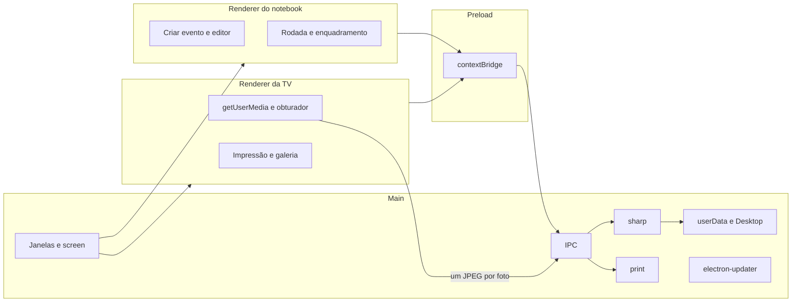
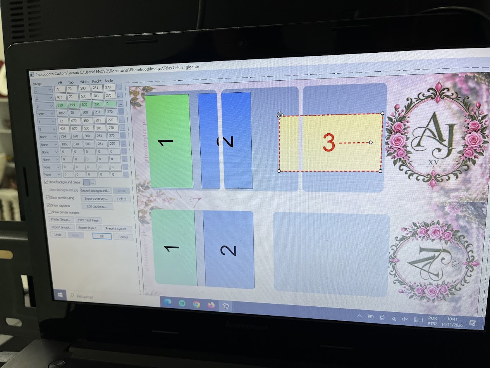
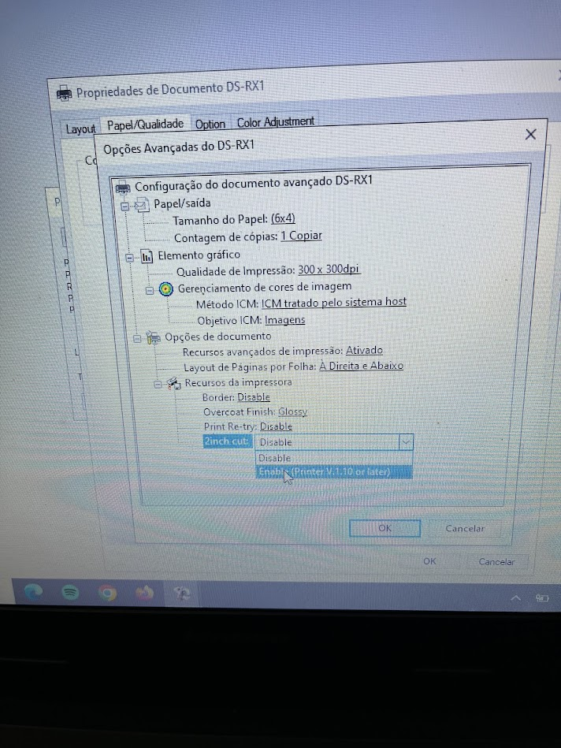
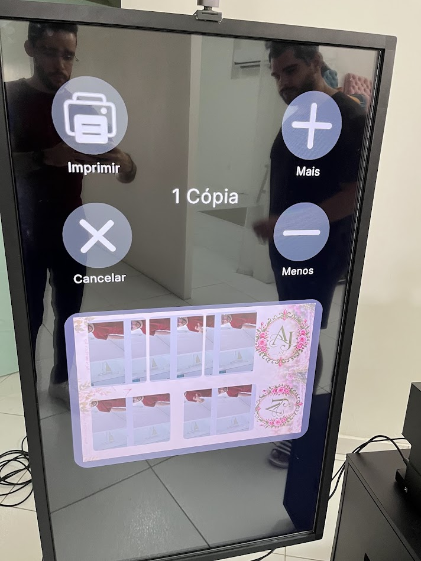
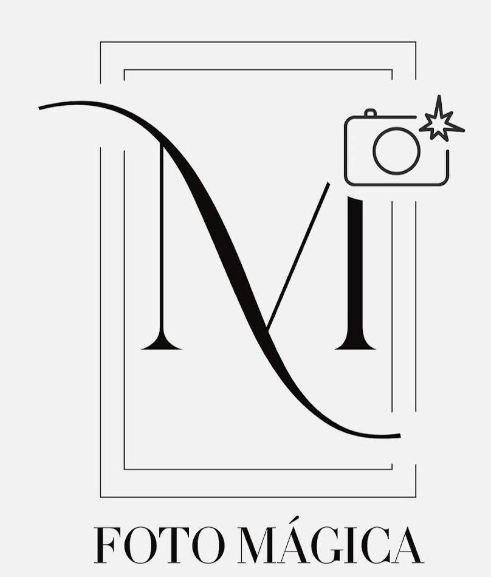

# Foto Mágica 2.0 — Desenho técnico e visual

> Como o app é construído. O que ele faz está em [PRD.md](./PRD.md). Se os dois discordarem, o PRD vence e este arquivo muda no mesmo PR.

O desenho de pastas segue o [PilatePay](https://github.com/ovinidev/PilatePay), lido em 2026-11-14 (`src/app`, `src/features/<nome>`, `src/shared`, `e2e/`, `docs/PRD.md`, `docs/DESIGN.md`). O PilatePay é um PWA com Supabase. Aqui não há backend: o processo principal do Electron ocupa o lugar do servidor, e o renderer repete o miolo feature-based. O linter de lá é o ESLint; o deste repo é o oxlint.

## 1. Stack

| Área | Escolha |
| --- | --- |
| Casca | Electron, duas `BrowserWindow` |
| UI | React + TypeScript estrito |
| Bundle | electron-vite (main, preload, renderer) |
| Notebook | Tailwind CSS + shadcn/ui, Inter empacotada com `@fontsource/inter` |
| TV | Superfície própria em `features/camera`, vidro fosco, sem skin de formulário |
| Validação | Zod na borda de cada canal de IPC e na leitura do JSON local |
| Imagem | `sharp`, isolado em `src/main/compose/` |
| Impressão | Módulo `src/main/print/`, com implementação Windows e implementação simulada |
| Atualização | electron-updater, provider GitHub |
| Instalador | electron-builder, alvo NSIS, no GitHub Actions |
| Testes | Vitest + Testing Library; Playwright com `_electron.launch` |
| Lint | oxlint (`.oxlintrc.json`). Sem ESLint |
| Pacotes | pnpm, Node `>= 22` |

## 2. Processos



- `nodeIntegration` desligado, `contextIsolation` ligado, `sandbox` ligado nas duas janelas
- O renderer não importa `electron` nem `fs`. Tudo passa pelo objeto único exposto no preload
- A prévia ao vivo não atravessa o processo principal: o quadro do notebook viaja num `MessageChannel` entre as duas janelas. Só a foto, no obturador, vai para o main como `Uint8Array` de JPEG
- O main é a fonte da verdade da rodada. Os dois renderers recebem o mesmo estado

## 3. Janelas e monitor da TV

`src/shared/displays.ts` exporta uma função pura. `src/main/windows/` só lê `screen.getAllDisplays()` e entrega a lista:

```ts
type DisplayInfo = {
  id: number
  primary: boolean
  x: number
  y: number
  width: number
  height: number
}

type GuestChoice =
  | { kind: 'portrait'; display: DisplayInfo }
  | { kind: 'landscape-external'; display: DisplayInfo }
  | { kind: 'missing' }
```

A escolha, na ordem:

1. Entre os monitores que não são o primário, o retrato (`height > width`) cuja proporção mais se aproxima de 9:16
2. Se só houver externo em paisagem, `landscape-external`
3. Se só houver o primário, `missing`

O módulo que lê `screen.getAllDisplays()` é fino e entrega `DisplayInfo[]` para essa função. O teste de unidade cobre as três saídas sem Electron. Com `FOTOMAGICA_E2E=1`, a lista vem de um fixture: primário 1920×1080 e um secundário 1080×1920. Assim o E2E não depende de dois monitores físicos.

A janela do operador abre no monitor primário, com moldura, tamanho confortável (mínimo 1280×800). A janela da TV não tem moldura, ignora o fechar acidental e cobre `bounds` do monitor escolhido. Quem a fecha é o main, no Encerrar evento ou ao sair do app.

A TV de referência é 1080×1920. Se o Windows reportar outra altura em retrato (por exemplo 2160×3840 em DIP diferentes), a UI da TV escala a partir de um quadro lógico de 1080×1920 para continuar com os mesmos alvos de 64 px proporcionais à tela. O cálculo dessa escala é função pura, com teste.

Samsung UN49MU6120, etiqueta do equipamento:


## 4. IPC

O preload expõe `window.fotomagica`. Cada método valida a entrada e a saída com Zod. Nomes de canal e schemas ficam em `src/shared/ipc/`, sem React e sem Electron, importados pelo main, pelo preload e pelo renderer. O renderer só chama o objeto tipado.

| Direção | Canal | Papel |
| --- | --- | --- |
| invoke | `event:start` | Nome, modo (`two-strips` ou `one-strip`) e o caminho do template desse modo. Devolve o monitor escolhido ou o erro |
| invoke | `event:end` | Fecha a TV e esquece a rodada não impressa |
| invoke | `layout:get` / `layout:save` | Lê e grava os dois layouts: cinco espaços em `two-strips`, três em `one-strip` |
| send | `session:request-shutter` | O notebook pede a captura. O main encaminha à TV |
| send | `session:photo` | A TV entrega o JPEG já girado e espelhado |
| invoke | `session:set-framing` | Pan, zoom e rotação de um espaço da rodada |
| invoke | `session:cancel` | Descarta a rodada |
| invoke | `session:print` | Cópias. Compõe, salva, imprime |
| invoke | `session:reprint` | Reenvia um JPG da pasta |
| invoke | `gallery:list` | Lista os JPG da pasta do evento |
| invoke | `webcam:get` / `webcam:set` | Constraints persistidas |
| invoke | `printer:status` | Estado atual |
| event | `session:state` | Main → as duas janelas, a cada mudança da rodada |
| event | `printer:status-changed` | Main → notebook e TV |

A TV é a única dona do `MediaStream`. O obturador do notebook não captura por conta própria: pede ao main, o main manda a TV executar o mesmo caminho (timer incluso).

## 5. Captura

A MX Brio fica montada na horizontal, no topo da TV. O sensor entrega paisagem. Quem põe a pessoa em pé é o software, como a rotação de 90° do Webcam Photobooth. Não há giro físico da câmera.

Ordem fixa, uma função só, usada pela prévia e pelo arquivo:

1. Quadro cru, ideal 3840×2160, 30 fps, sem áudio
2. Rotação para retrato. O ângulo mora em `CAMERA_ROTATION_DEG`, valor inicial `90`, num único arquivo. Trocar o sinal dessa constante vira a imagem se o primeiro teste no hardware mostrar a pessoa de cabeça para baixo
3. Espelhamento horizontal

`getUserMedia` pede `width` e `height` ideais 3840 e 2160. Se a câmera recusar, fica o maior modo que ela entregar. O dispositivo preferido é aquele cujo rótulo contém `MX Brio`. Sem ele, o primeiro `videoinput`. Com mais de uma câmera e nenhuma Brio, o criar evento mostra um select.

A prévia da TV desenha esse quadro num canvas, com `requestAnimationFrame`. A câmera abre uma vez, na TV. No início do evento o main entrega um `MessageChannel` às duas janelas. A TV transfere, a cada frame, um `ImageBitmap` já girado e espelhado, no tamanho da prévia do notebook, e descarta o frame se o notebook ainda não consumiu o anterior. Isso não passa pelo `invoke` e não grava disco. O JPEG em resolução cheia continua sendo um único envio, no obturador.

No obturador a TV exporta um JPEG qualidade 95 do quadro já transformado (retrato, espelhado) e envia os bytes. O main guarda as três capturas na rodada. Não escreve essas três no disco.

### Constraints

O painel lê `track.getCapabilities()` e só desenha o que existir:

| Controle | Constraint |
| --- | --- |
| Brilho | `brightness` |
| Contraste | `contrast` |
| Saturação | `saturation` |
| Nitidez | `sharpness` |
| Balanço de branco | `whiteBalanceMode` e, no manual, `colorTemperature` |
| Ganho | `gain`, ou o nome que a capability trouxer para o ganho da figura 8 |
| Luz de fundo | `backlightCompensation`, somente se existir |

`applyConstraints` roda na TV. O valor salvo vai junto no `webcam:set`. Na abertura do evento a TV reaplica o JSON. `powerLineFrequency`, se existir, é fixado em 60, sem controle na tela.

Os números visíveis na figura 8 (brilho 145, contraste 111, e o resto) são o estado daquele Windows no dia da foto. O app não os copia como padrão de fábrica: mostra o que a câmera reportar e persiste o que o operador mudar.

## 6. Montagem

A folha lógica é 1844×1240 px, 300 DPI. É o “print extent” do app atual. Os 1800×1200 que também aparecem no diálogo são a área interna: 1844 − 22 − 22 e 1240 − 20 − 20.


`src/main/compose/renderSheet.ts` é função pura em cima de buffers. O `sharp` fica numa casca fina que essa função chama, para o teste poder substituir.

Para cada espaço, nessa ordem:

1. A captura da foto indicada (1, 2 ou 3), já em pé e espelhada
2. Encaixe `cover` no retângulo não rotacionado (`width` × `height`), com o pan, o zoom (1 a 3) e a rotação de enquadramento daquele espaço. Zoom 1 e pan 0 cortam o centro: num espaço horizontal, o retrato perde topo e base em partes iguais
3. Rotação do resultado pelo `angle` do espaço, em torno do centro
4. Composição sobre o template daquele modo em `left`, `top`

O modo escolhido só muda qual layout e qual template entram. Os dois preenchem os 1844×1240. O modo 1 tira não pinta uma metade de branco.

O teste de ouro não depende de adivinhar o pivô: um quadro com uma barra clara no topo tem de mostrar essa barra no topo de cada espaço. No modo 2 tiras, as três de cima ficam verticais e as duas de baixo horizontais. No modo 1 tira, os três espaços do seed ficam verticais e a folha não tem metade vazia. Se um ângulo de 270 deitar a pessoa, o sinal da rotação do espaço está errado e o teste falha.

Depois dos espaços do modo, o `sharp` grava JPEG qualidade 95, densidade 300, 1844×1240. Esse é o arquivo `HH-mm-ss.jpg`.

A linha de corte usada pelo editor, só no layout de 2 tiras, é y = 620. É suposição de trabalho, pendente do cliente, junto com as medidas dos quadrados cinzas. Até esses dados chegarem, o espaço que cruza essa linha não impede salvar, e o editor mostra aviso. O layout de 1 tira não desenha essa linha.

### Modelo do editor

Left e Top são o canto superior esquerdo do retângulo antes da rotação. Width e Height não trocam quando o ângulo muda. A rotação é em torno do centro. O painel mostra esses números inteiros.

No app atual, Angle 270 com 500×281 desenha um espaço alto, e Angle 0 desenha um espaço deitado. O renderer novo reproduz isso. O número da foto é desenhado no espaço local, então gira junto, como na demonstração: na vertical o “3” fica de lado. É o comportamento do app atual, e o editor mantém.



## 7. Editor fluido e snap

O editor tem um seletor de modo. `two-strips` mostra os cinco espaços e a linha de corte. `one-strip` mostra os três. Os gestos abaixo valem para os dois. O travamento do Webcam Photobooth vem de refazer o layout inteiro, ou de falar com o processo, a cada movimento do mouse. O editor novo trata o gesto assim:

- `pointerdown` no espaço ou na alça guarda a origem
- `pointermove` atualiza um ref e escreve direto no transform do DOM e no `value` dos campos Left, Top, Angle, Width e Height, no mesmo frame
- Não há `invoke` nem escrita em disco enquanto o botão está preso
- `pointerup` commita o estado React e chama `layout:save` uma vez, gravando só o layout que está na tela (`two-strips` ou `one-strip`)

Alças: noroeste, norte, nordeste, leste, sudeste, sul, sudoeste, oeste, nos cantos e nos meios das arestas do retângulo já rotacionado. A alça de rotação fica para fora do meio da aresta inferior, ligada ao centro por uma haste tracejada. No vídeo do editor atual, com o espaço em pé, essa haste aponta para baixo e o número gira junto com o espaço.

O snap é função pura `snap(draft, others, modifiers) -> draft`:

| Alvo | Onde |
| --- | --- |
| Folha | x = 0 e 1844, y = 0 e 1240, centro x = 922, y = 620 |
| Margem de impressão | x = 22 e 1822, y = 20 e 1220 |
| Corte | y = 620, somente no layout de 2 tiras |
| Outros espaços | arestas e centro do retângulo já rotacionado |

A tolerância é 8 px no espaço da folha, não em pixels da tela. O giro também encosta em 0, 90, 180 e 270 dentro de 4°. Alt preso devolve o draft sem alteração. O teste de unidade cobre encostar, não encostar e o Alt.

Tamanho mínimo do espaço: 40×40 px, para a alça não inverter o retângulo.

## 8. Enquadramento da rodada

Isto não é o editor de espaços. Com a festa aberta, o espaço fica parado. O gesto na prévia do notebook mexe na foto dentro dele: arrastar move, a roda dá zoom, uma alça pequena (cor de tinta, não o vermelho do editor) gira a foto. Cada espaço da rodada tem o seu pan, zoom e rotação, inclusive quando dois espaços usam a mesma captura.

O notebook mostra, ao lado, a câmera sem cromado de iPhone, no retrato inteiro. No modo 2 tiras, um retângulo guia marca a faixa horizontal da tira de baixo. No modo 1 tira, o guia segue o espaço retrato da próxima foto.

## 9. Persistência

| Dado | Lugar |
| --- | --- |
| Os dois layouts, os dois templates, webcam, nome da impressora | `app.getPath('userData')/config.json` |
| Cópia do template do modo e meta do evento aberto (nome, modo, id) | `app.getPath('userData')/events/<id>/` |
| Montagem JPG | `app.getPath('desktop')/<nome do evento>/HH-mm-ss.jpg` |

O nome da pasta passa por uma função pura: trim, recusa vazio, recusa caracteres `\ / : * ? " < > |`, recusa nome reservado do Windows, recusa ponto ou espaço no fim. O teste lista esses casos.

Hora do arquivo: hora local, 24 h, `HH-mm-ss.jpg`. Colisão no mesmo segundo acrescenta `-2`, `-3`, função pura sobre a lista de nomes já existentes.

A rodada (três JPEG e os enquadramentos) fica na memória do main. Não há rascunho. Fechar o processo antes do Imprimir perde a rodada.

O JSON é lido com Zod. Arquivo ausente ou inválido volta aos dois seeds do PRD e a webcam vazia, sem derrubar a abertura. Um layout inválido não apaga o outro.

## 10. Impressão

Só `src/main/print/` conhece driver, diálogo ou simulação. React pede `printer:status` e `session:print`.

```ts
type PrintMode = 'two-strips' | 'one-strip'

type PrinterStatus =
  | { kind: 'ready' }
  | { kind: 'offline' }
  | { kind: 'no-paper' }
  | { kind: 'no-ribbon' }
  | { kind: 'unknown'; detail: string }

type PrintTicket = {
  jpegPath: string
  copies: number
  mode: PrintMode
  cut: boolean
}

type PrintResult =
  | { ok: true }
  | { ok: false; reason: 'offline' | 'no-paper' | 'no-ribbon' | 'cut-unavailable' | 'failed'; detail: string }
```

Duas implementações da mesma interface:

- `SimulatedPrinter`, usada com `FOTOMAGICA_PRINTER=simulated`. Copia o JPEG para `userData/simulated-prints/` e grava o ticket em JSON. `FOTOMAGICA_PRINTER_STATUS` força `ready`, `offline`, `no-paper` ou `no-ribbon`. `FOTOMAGICA_PRINTER_CUT=unsupported` devolve `cut-unavailable`
- `WindowsDnpPrinter`, a única que fala com o spooler. Escolhe a fila cujo nome contém `DS-RX1`

A impressão real é silenciosa (`silent: true`, `deviceName` da fila). O diálogo do Windows não abre. Papel 6,00" × 4,00" (152 × 102 mm), 300 DPI, orientação Portrait, igual à figura 10. O bitmap não é girado de novo.

O corte de 2" é a flag que o driver mostra como `2inch cut`: `Disable` ou `Enable (Printer V.1.10 or later)`.

- Em `two-strips` o main pede `Enable` e compõe os cinco espaços sobre o template desse modo. Se o driver não aceitar ligar o corte, o resultado é `cut-unavailable` e a UI não trata a folha como impressa.
- Em `one-strip` o main pede `Disable` e compõe os três espaços sobre o template desse modo, preenchendo a folha 1844×1240. Não há metade em branco e não há papel 6×2. Se o driver não aceitar desligar o corte, o resultado também é `cut-unavailable`: a folha não sai cortada por engano.



Status, a partir do que o Windows expuser (flags do tipo offline e sem papel, e o que mais a fila DS-RX1 preencher):

| Estado | Mensagem |
| --- | --- |
| offline / desligada | Impressora desligada |
| sem papel | Impressora sem papel |
| sem ribbon | Impressora sem ribbon |
| flag ausente | O driver não informou papel nem ribbon |

Outras opções visíveis no driver (borda, overcoat glossy, print re-try, layout da página) não são alteradas por este app.

Ordem do Imprimir: compor, gravar o JPG na pasta do evento, então enviar. Se o envio falha, o arquivo fica e a rodada continua na tela de impressão. Se a gravação falha, não há impressão e a tela não anuncia sucesso.

Cópias: o ticket leva de 1 a 10, teto aprovado pelo dono. Cada cópia é uma folha 6×4. Em `two-strips` a faca divide a folha. Em `one-strip` a folha sai inteira, com as três fotos.

## 11. Atualização e assinatura

electron-updater com provider GitHub, no repositório `ovinidev/PhotoMagic`. A checagem roda na abertura, somente sem evento em andamento. Falha de rede é ignorada: o app abre. O download não ocupa a TV. A instalação acontece ao sair, quando uma versão nova já tiver sido baixada.

O instalador publicado se chama `FotoMagica-Setup.exe`, para o endereço estável:

`https://github.com/ovinidev/PhotoMagic/releases/latest/download/FotoMagica-Setup.exe`

Assinatura, no job do Windows, só entra se os secrets estiverem preenchidos:

- `CSC_LINK`: certificado `.pfx` em base64
- `CSC_KEY_PASSWORD`

`CSC_IDENTITY_AUTO_DISCOVERY` fica `false`. O step exporta `CSC_LINK` e `CSC_KEY_PASSWORD` apenas quando o secret é não vazio. Sem eles o electron-builder gera o instalador sem assinatura e o job termina verde. O workflow não guarda o certificado no repositório.

NSIS: por máquina, atalho na área de trabalho, diretório de instalação escolhível. `appId`: `com.fotomagica.desktop`. `productName`: `Foto Mágica`.

Ícone do builder: `assets/brand/icon.png` (símbolo sobre fundo claro). O builder emite o `.ico` com 16, 32, 48 e 256. A logo completa não vai para o ícone pequeno, porque o texto não sobrevive a 16 px.

## 12. CI e testes

O workflow ainda não está no repositório. A primeira implementação que criar o app adiciona `.github/workflows/ci.yml` com este contrato.

**Em todo pull request e em todo push**

- Node 22, pnpm com lockfile congelado
- `pnpm typecheck`
- `pnpm lint` (`oxlint .`, avisos reprovam)
- `pnpm test:coverage`
- `pnpm exec playwright install --with-deps chromium` quando o runner for Linux
- `pnpm test:e2e` com `FOTOMAGICA_E2E=1` e `FOTOMAGICA_PRINTER=simulated`

O E2E de pull request pode rodar em `ubuntu-latest`: a impressora é simulada, a câmera é fixture e o segundo monitor é injetado. O que é específico de Windows (DEVMODE, assinatura, NSIS) fica no job de empacotar.

**No push da `main`, job extra em `windows-latest`**

- `pnpm dist` (electron-builder `--win`)
- Publica GitHub Release quando `package.json` `version` ainda não existe como release
- Assina só com os secrets presentes, como na seção 11

Um push que não sobe a versão gera o instalador como artefato do workflow e não cria outra release. O electron-updater só enxerga release publicada.

### O que o teste cobre

Regra pura, ao lado do arquivo, em Vitest:

- escolha do monitor
- snap, inclusive Alt e o snap de ângulo
- nome de pasta e nome `HH-mm-ss`
- tamanho do template
- encaixe `cover` com barra no topo (RF08)
- mapeamento do ticket: `two-strips` pede corte ligado, `one-strip` pede corte desligado e compõe três espaços na folha inteira

E2E, em `e2e/`, um spec por fluxo, no Electron de verdade:

| Spec | Fluxo |
| --- | --- |
| `create-event.spec.ts` | Nome, template certo e errado, pasta |
| `layout-editor.spec.ts` | Arraste com painel ao vivo, snap, uma gravação no soltar, os dois layouts independentes |
| `capture-round.spec.ts` | Três fotos, contador, timer, cancelar |
| `print.spec.ts` | Ticket simulado, cópias, falha de status, arquivo único |
| `gallery.spec.ts` | Lista, tela cheia, reimprimir |
| `resilience.spec.ts` | Webcam some no meio, TV segue respondendo, encerrar fecha a TV |

Cenário do PRD cuja tela ainda não existe fica `test.fixme`, com o id do requisito no título, e vira teste no PR que faz a tela. O E2E não aponta para a DS-RX1 nem para a MX Brio.

Hook husky `pre-push`: typecheck, lint, `pnpm test`, `pnpm test:e2e`. Igual ao papel do hook no PilatePay.

oxlint, configuração mínima esperada: plugins `react`, `typescript` e `import`; categoria `correctness` em erro; regra de hooks do React em erro; ignorar `dist`, `out`, `release`, `coverage`, `playwright-report`. Sem arquivo de ESLint ao lado.

## 13. Pastas

```
src/
  shared/                sem React e sem Electron
    ipc/                 nomes de canal e schemas Zod
    layout/              snap, seed, geometria
    capture/             rotação, espelho, cover
    files/               nome de pasta e HH-mm-ss
    displays.ts          escolha do monitor da TV
  main/
    index.ts
    windows/             lê screen e chama a função pura de displays
    ipc/                 handlers, um módulo por área
    session/             estado da rodada
    compose/             casca do sharp em volta de renderSheet
    print/               types.ts, SimulatedPrinter.ts, WindowsDnpPrinter.ts
    persist/             config.json e a meta do evento
    updater/
  preload/
    index.ts             contextBridge
  renderer/
    operator.html
    guest.html
    app/                 rotas do notebook e casca da TV
    features/
      events/            criar evento, nome, template do modo, 2 tiras ou 1 tira
      layout/            editor e alças
      session/           prévia da montagem e enquadramento no notebook
      camera/            TV: ao vivo, obturador, timer, grade
      print/             tela de impressão da TV
      gallery/
      webcam/            painel de constraints
    shared/
      components/ui/     shadcn, usado pelo notebook
      hooks/
      utils/
e2e/
docs/
  PRD.md
  DESIGN.md
  assets/briefing/       figuras image1.png … image13.png
assets/brand/
  logo.png               lockup transparente
  mark.png               símbolo transparente, 1024
  icon.png               símbolo em fundo claro, fonte do .ico
```

Regras, as mesmas do PilatePay:

- Feature importa `shared/` e o `index.ts` de outra feature
- `shared/` não importa feature nem `app/`
- Só se criam as subpastas que a feature usa (`components/`, `hooks/`, `utils/`, `pages/`)
- A tela inicial não é uma feature: é página de `app/` que compõe `events` e `layout`
- O main importa tipos e funções puras de `src/shared/`, nunca um componente
- Alias `@shared` aponta para `src/shared`. Alias `@brand` aponta para `assets/brand`, de onde a UI importa `logo.png`

Não há `supabase/`, `vercel.json` nem cliente de API. Não há TanStack Query: o estado de servidor do PilatePay aqui é o IPC.

## 14. Design visual

Duas superfícies. O notebook é papel claro. A TV é a câmera do iPhone, escura e translúcida, por cima da imagem. Light mode do requisito vale para o notebook. A TV não é um formulário claro, porque a referência da figura 7 é a câmera.

### Tokens

Ficam em `src/renderer/index.css`, como variáveis, e o Tailwind 4 as lê no `@theme`.

| Token | Valor | Uso |
| --- | --- | --- |
| `--bg` | `#F4F1EB` | Fundo do notebook |
| `--bg-raised` | `#FBF9F6` | Cartão, painel, campo |
| `--ink` | `#1C1917` | Texto e botão primário |
| `--ink-soft` | `#57534E` | Texto secundário |
| `--line` | `#E7E0D6` | Fio, borda de campo |
| `--primary` | `#1C1917` | Botão cheio |
| `--primary-ink` | `#FBF9F6` | Texto do botão cheio |
| `--danger` | `#9F1239` | Erro de impressora, destrutivo |
| `--selection` | `#E11D48` | Borda tracejada e alças do editor |
| `--ok` | `#3F6212` | Impressora pronta |
| `--glass` | `rgba(28, 28, 30, 0.42)` | Barras da TV |
| `--glass-strong` | `rgba(28, 28, 30, 0.62)` | Painel de ajustes sobre a imagem |
| `--shutter` | `#FFFFFF` | Botão de captura |

Sem roxo de destaque e sem o vinho do PilatePay. A cor da marca é o preto da logo. O vermelho existe para o editor continuar reconhecível para quem usava o app atual, e para erro.

Inter, pesos 400, 500 e 600, arquivos locais. A palavra FOTO MÁGICA na interface é a logo, não texto com outra fonte. Números de contagem e de relógio usam dígitos tabulares.

### Notebook

Fundo `--bg`, cartões `--bg-raised`, borda de 1 px `--line`, raio 12 px nos cartões e 8 px nos campos. Botão primário é preto com texto claro. Botão secundário é fantasma, borda `--line`. Foco visível: anel de 2 px `--ink`, offset 2 px.

Cabeçalho com o símbolo e o nome do evento quando houver. A tela inicial centraliza a logo completa, o nome, o modo (2 tiras ou 1 tira) e o arquivo daquele modo. Uma coluna só, largura máxima 720 px, porque é um formulário curto e não um dashboard.

O editor é a exceção de largura: a folha 1844×1240 escala para caber na janela, com o painel de números numa coluna fixa de 320 px à esquerda, na mesma ordem do app atual (foto, Left, Top, Width, Height, Angle).

Estados de vazio, de erro e de carregamento existem em toda tela do notebook. Vazio da galeria: “Nenhuma montagem ainda”. Erro de template: as dimensões lidas e as esperadas. Carregar o arquivo: o botão mostra espera e não dispara duas vezes.

### TV

Quadro lógico 1080×1920.

- A imagem ocupa o miolo, de borda a borda, já espelhada
- Barra superior de vidro: ícone de ajustes (no lugar do flash) e o interruptor da grade de terços. Sem ícone de virar câmera
- Barra inferior de vidro: miniatura circular de 96 px da última montagem à esquerda; o botão branco no centro, 96 px de diâmetro dentro de um anel; o timer (desligado, 5 s, 10 s) como três alvos à direita do botão, cada um com pelo menos 64 px
- Contador `1/3` acima do botão, em branco, peso 600
- Contagem regressiva no centro da imagem, cerca de 18% da altura lógica
- `backdrop-filter: blur(24px)`. Se o compositor não tiver blur, a barra cai para `rgba(28, 28, 30, 0.72)`, opaca o bastante para o rótulo continuar legível

A grade de terços são fios brancos a 20% de opacidade. Desligada, some por completo.

A tela de impressão mantém a imagem da última prévia ao fundo, escurecida, e flutua os controles como na figura 9: Imprimir e Cancelar de um lado, Mais e Menos do outro, a quantidade no centro, a prévia da folha embaixo. Cada alvo tem no mínimo 64 px; o círculo desenhado pode ser maior. Rótulo embaixo do ícone, em branco: Imprimir, Cancelar, Mais, Menos.



Uma marca da logo, só o símbolo, pode sentar no canto da tela de impressão, fora da prévia da folha, a não mais que 48 px de altura. A imagem ao vivo, a contagem e a prévia da folha não levam logo.

### Movimento

O obturador pisca um branco de 80 ms. A contagem troca de número sem bounce. O editor não anima o espaço durante o arraste: ele cola no ponteiro, já com o snap aplicado, e o painel mostra esse valor no mesmo frame.

`prefers-reduced-motion` desliga o pisca e a transição de barra. O snap e a contagem permanecem, porque são informação, não enfeite.

## 15. Logo

O briefing entregou a logo com fundo cinza sólido `(242, 242, 242)`.

| Arquivo | O que é |
| --- | --- |
| `docs/assets/briefing/image6.png` | Original, fundo cinza |
| `assets/brand/logo.png` | Lockup com fundo removido. O alfa vem de tratar o pixel como tinta preta sobre 242 |
| `assets/brand/mark.png` | Símbolo (M, moldura, câmera), sem a frase, 1024×1024, transparente |
| `assets/brand/icon.png` | O mesmo símbolo sobre `#F4F1EB`, opaco, fonte do `.ico` |

O recorte foi feito no raster. As bordas finas da moldura e da câmera aguentam fundo claro e fundo escuro no tamanho de tela. Em 16 px elas entopem. Quando o cliente tiver o SVG, ele substitui `logo.png` e `mark.png`; o `icon.png` é regerado a partir do símbolo, de novo sobre o fundo claro, para a barra de tarefas escura do Windows não engolir o traço preto.



## 16. Figuras do briefing usadas aqui

As treze estão em `docs/assets/briefing/`. As que este desenho não repetiu ficam no PRD: montagem física (image7), notebook (image13), painel de números (image1), câmera atual (image9), referência do iPhone (image5), ajustes da webcam (image10) e a tela de configurações que não volta (image11).
