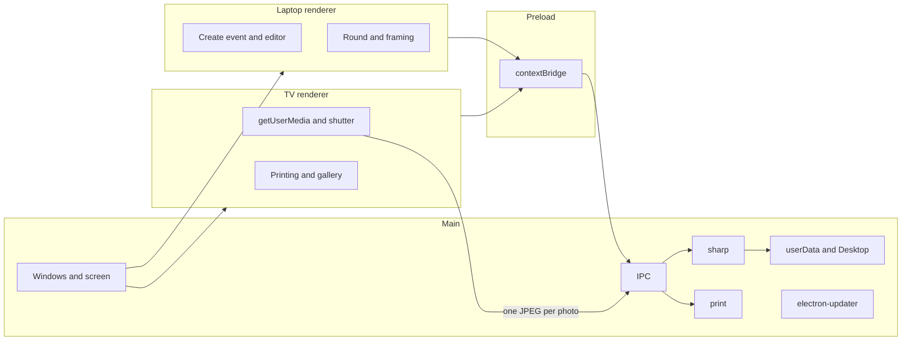
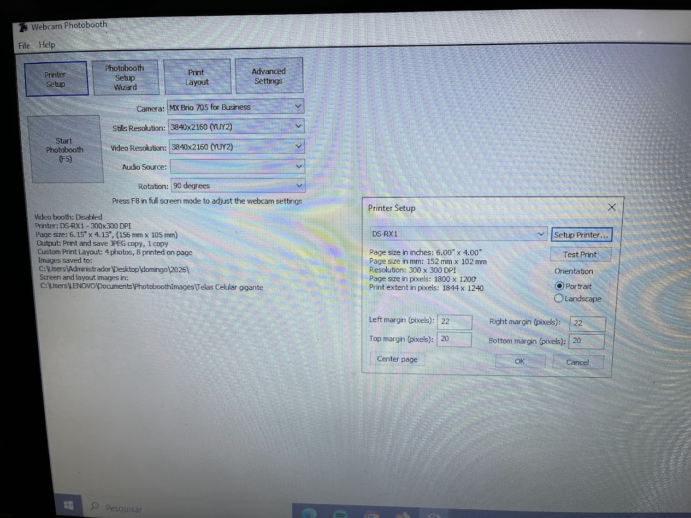

# Foto Mágica 2.0 — Technical and visual design

> How the app is built. What it does is in [PRD.md](./PRD.md). If the two disagree, the PRD wins and this file changes in the same PR.
>
> **Language note.** This document is written in English. End-user UI strings (labels, messages, empty states) stay in pt-BR and are quoted verbatim.

The folder layout follows [PilatePay](https://github.com/ovinidev/PilatePay), read on 2026-11-14 (`src/app`, `src/features/<name>`, `src/shared`, `e2e/`, `docs/PRD.md`, `docs/DESIGN.md`). PilatePay is a PWA with Supabase. Here there is no backend: Electron's main process takes the place of the server, and the renderer repeats the feature-based core. Its linter is ESLint; this repo's is oxlint.

## 1. Stack

| Area | Choice |
| --- | --- |
| Shell | Electron, two `BrowserWindow`s |
| UI | React + strict TypeScript |
| Bundle | electron-vite (main, preload, renderer) |
| Laptop | Tailwind CSS + shadcn/ui, Inter bundled with `@fontsource/inter` |
| TV | Own surface in `features/camera`, frosted glass, no form skin |
| Validation | Zod at the edge of every IPC channel and when reading local JSON |
| Image | `sharp`, isolated in `src/main/compose/` |
| Printing | Module `src/main/print/`, with a Windows implementation and a simulated implementation |
| Update | electron-updater, GitHub provider |
| Installer | electron-builder, NSIS target, on GitHub Actions |
| Tests | Vitest + Testing Library; Playwright with `_electron.launch` |
| Lint | oxlint (`.oxlintrc.json`). No ESLint |
| Packages | pnpm, Node `>= 22` |

## 2. Processes



- `nodeIntegration` off, `contextIsolation` on, `sandbox` on in both windows
- The renderer imports neither `electron` nor `fs`. Everything goes through the single object exposed by the preload
- The live preview does not cross the main process: the laptop frame travels over a `MessageChannel` between the two windows. Only the photo, at the shutter, goes to main as a JPEG `Uint8Array`
- Main is the source of truth for the round. Both renderers receive the same state

## 3. Windows and the TV monitor

`src/shared/displays.ts` exports a pure function. `src/main/windows/` only reads `screen.getAllDisplays()` and hands over the list:

```ts
type DisplayInfo = {
  id: number
  primary: boolean
  x: number
  y: number
  width: number
  height: number
}

type GuestChoice =
  | { kind: 'portrait'; display: DisplayInfo }
  | { kind: 'landscape-external'; display: DisplayInfo }
  | { kind: 'missing' }
```

The choice, in order:

1. Among the monitors that are not the primary, the portrait one (`height > width`) whose aspect ratio is closest to 9:16
2. If there is only a landscape external, `landscape-external`
3. If there is only the primary, `missing`

The module that reads `screen.getAllDisplays()` is thin and hands `DisplayInfo[]` to this function. The unit test covers the three outputs without Electron. With `FOTOMAGICA_E2E=1`, the list comes from a fixture: primary 1920×1080 and a secondary 1080×1920. This way E2E does not depend on two physical monitors.

The operator window opens on the primary monitor, with a frame and a comfortable size (minimum 1280×800). The TV window has no frame, ignores accidental close and covers the `bounds` of the chosen monitor. Main closes it, on `Encerrar evento` or when quitting the app.

The reference TV is 1080×1920. If Windows reports another portrait height (for example 2160×3840 at different DIPs), the TV UI scales from a logical frame of 1080×1920 to keep the same 64 px targets proportional to the screen. The computation of that scale is a pure function, with a test.

Samsung UN49MU6120, equipment label:


## 4. IPC

The preload exposes `window.fotomagica`. Each method validates input and output with Zod. Channel names and schemas live in `src/shared/ipc/`, with no React and no Electron, imported by main, preload and renderer. The renderer only calls the typed object.

| Direction | Channel | Role |
| --- | --- | --- |
| invoke | `event:start` | Name, mode (`two-strips` or `one-strip`) and the path of that mode's template. Returns the chosen monitor or the error |
| invoke | `event:end` | Closes the TV and forgets the unprinted round |
| invoke | `layout:get` / `layout:save` | Reads and writes both layouts: five slots in `two-strips`, three in `one-strip` |
| send | `session:request-shutter` | The laptop requests the capture. Main forwards it to the TV |
| send | `session:photo` | The TV delivers the already rotated and mirrored JPEG |
| invoke | `session:set-framing` | Pan, zoom and rotation of one slot of the round |
| invoke | `session:cancel` | Discards the round |
| invoke | `session:print` | Copies. Composes, saves, prints |
| invoke | `session:reprint` | Resends a JPG from the folder |
| invoke | `gallery:list` | Lists the JPGs in the event folder |
| invoke | `webcam:get` / `webcam:set` | Persisted constraints |
| invoke | `printer:status` | Current state |
| event | `session:state` | Main → both windows, on every round change |
| event | `printer:status-changed` | Main → laptop and TV |

The TV is the sole owner of the `MediaStream`. The laptop's shutter does not capture on its own: it asks main, and main tells the TV to run the same path (timer included).

## 5. Capture

The MX Brio is mounted horizontally, on top of the TV. The sensor delivers landscape. Software stands the person upright, like the 90° rotation of Webcam Photobooth. There is no physical rotation of the camera.

Fixed order, a single function, used by the preview and by the file:

1. Raw frame, ideally 3840×2160, 30 fps, no audio
2. Rotation to portrait. The angle lives in `CAMERA_ROTATION_DEG`, initial value `90`, in a single file. Flipping the sign of this constant turns the image over if the first test on the hardware shows the person upside down
3. Horizontal mirroring

`getUserMedia` asks for ideal `width` and `height` of 3840 and 2160. If the camera refuses, the largest mode it delivers is kept. The preferred device is the one whose label contains `MX Brio`. Without it, the first `videoinput`. With more than one camera and no Brio, create-event shows a select.

The TV preview draws this frame on a canvas, with `requestAnimationFrame`. The camera opens once, on the TV. At the start of the event main hands a `MessageChannel` to both windows. On every frame the TV transfers an `ImageBitmap`, already rotated and mirrored, at the size of the laptop preview, and drops the frame if the laptop has not yet consumed the previous one. This does not go through `invoke` and does not write to disk. The full-resolution JPEG remains a single send, at the shutter.

At the shutter the TV exports a quality-95 JPEG of the already transformed frame (portrait, mirrored) and sends the bytes. Main keeps the three captures in the round. It does not write those three to disk.

### Constraints

The panel reads `track.getCapabilities()` and only draws what exists:

| Control | Constraint |
| --- | --- |
| Brightness | `brightness` |
| Contrast | `contrast` |
| Saturation | `saturation` |
| Sharpness | `sharpness` |
| White balance | `whiteBalanceMode` and, in manual, `colorTemperature` |
| Gain | `gain`, or whatever name the capability uses for the gain in figure 8 |
| Backlight | `backlightCompensation`, only if it exists |

`applyConstraints` runs on the TV. The saved value goes along in `webcam:set`. When the event opens, the TV reapplies the JSON. `powerLineFrequency`, if it exists, is fixed at 60, with no control on screen.

The numbers visible in figure 8 (brightness 145, contrast 111, and the rest) are the state of that Windows on the day of the photo. The app does not copy them as factory defaults: it shows what the camera reports and persists what the operator changes.

## 6. Montage

The logical sheet is 1844×1240 px, 300 DPI. It is the "print extent" of the current app. The 1800×1200 that also appears in the dialog is the inner area: 1844 − 22 − 22 and 1240 − 20 − 20.



`src/main/compose/renderSheet.ts` is a pure function over buffers. `sharp` sits in a thin shell that this function calls, so the test can replace it.

For each slot, in this order:

1. The capture of the indicated photo (1, 2 or 3), already upright and mirrored
2. `cover` fit into the unrotated rectangle (`width` × `height`), with that slot's pan, zoom (1 to 3) and framing rotation. Zoom 1 and pan 0 crop the center: in a horizontal slot, the portrait loses top and bottom in equal parts
3. Rotation of the result by the slot's `angle`, around the center
4. Composition over that mode's template at `left`, `top`

The chosen mode only changes which layout and which template are used. Both fill the 1844×1240. The 1 tira mode does not paint half of it white.

The golden test does not depend on guessing the pivot: a frame with a light bar at the top must show that bar at the top of each slot. In 2 tiras mode, the top three are vertical and the bottom two horizontal. In 1 tira mode, the three seed slots are vertical and the sheet has no empty half. If an angle of 270 lays the person down, the sign of the slot rotation is wrong and the test fails.

After the mode's slots, `sharp` writes a quality-95 JPEG, density 300, 1844×1240. This is the `HH-mm-ss.jpg` file.

The cut line used by the editor, only in the 2-strip layout, is y = 620. It is a working assumption, pending from the client, along with the measurements of the gray squares. Until that data arrives, a slot that crosses this line does not prevent saving, and the editor shows a warning. The 1-strip layout does not draw this line.

### Editor model

Left and Top are the top-left corner of the rectangle before rotation. Width and Height do not swap when the angle changes. Rotation is around the center. The panel shows these numbers as integers.

In the current app, Angle 270 with 500×281 draws a tall slot, and Angle 0 draws a lying-down slot. The new renderer reproduces this. The photo number is drawn in the slot's local space, so it rotates with it, as in the demonstration: vertically the "3" is sideways. This is the current app's behavior, and the editor keeps it.


## 7. Fluid editor and snap

The editor has a mode selector. `two-strips` shows the five slots and the cut line. `one-strip` shows the three. The gestures below apply to both. Webcam Photobooth's freezing comes from redoing the whole layout, or from talking to the process, on every mouse move. The new editor handles the gesture like this:

- `pointerdown` on the slot or the handle stores the origin
- `pointermove` updates a ref and writes directly to the DOM transform and to the `value` of the Left, Top, Angle, Width and Height fields, in the same frame
- There is no `invoke` and no disk write while the button is held
- `pointerup` commits the React state and calls `layout:save` once, writing only the layout that is on screen (`two-strips` or `one-strip`)

Handles: northwest, north, northeast, east, southeast, south, southwest, west, at the corners and at the midpoints of the edges of the already rotated rectangle. The rotation handle sits outside the middle of the bottom edge, connected to the center by a dashed rod. In the current editor's video, with the slot upright, this rod points down and the number rotates with the slot.

Snap is a pure function `snap(draft, others, modifiers) -> draft`:

| Target | Where |
| --- | --- |
| Sheet | x = 0 and 1844, y = 0 and 1240, center x = 922, y = 620 |
| Print margin | x = 22 and 1822, y = 20 and 1220 |
| Cut | y = 620, only in the 2-strip layout |
| Other slots | edges and center of the already rotated rectangle |

The tolerance is 8 px in sheet space, not screen pixels. Rotation also snaps to 0, 90, 180 and 270 within 4°. Alt held returns the draft unchanged. The unit test covers snapping, not snapping and Alt.

Minimum slot size: 40×40 px, so the handle does not invert the rectangle.

## 8. Round framing

This is not the slot editor. With the party open, the slot stays still. The gesture on the laptop preview moves the photo inside it: dragging moves, the wheel zooms, a small handle (ink color, not the editor's red) rotates the photo. Each slot of the round has its own pan, zoom and rotation, including when two slots use the same capture.

Next to it, the laptop shows the camera without the iPhone chrome, in the full portrait. In 2 tiras mode, a guide rectangle marks the horizontal band of the bottom strip. In 1 tira mode, the guide follows the portrait slot of the next photo.

## 9. Persistence

| Data | Location |
| --- | --- |
| Both layouts, both templates, webcam, printer name | `app.getPath('userData')/config.json` |
| Copy of the mode's template and meta of the open event (name, mode, id) | `app.getPath('userData')/events/<id>/` |
| JPG montage | `app.getPath('desktop')/<event name>/HH-mm-ss.jpg` |

The folder name goes through a pure function: trim, reject empty, reject the characters `\ / : * ? " < > |`, reject reserved Windows names, reject a trailing dot or space. The test lists these cases.

File time: local time, 24 h, `HH-mm-ss.jpg`. A collision in the same second appends `-2`, `-3`, a pure function over the list of existing names.

The round (three JPEGs and the framings) lives in main's memory. There is no draft. Closing the process before `Imprimir` loses the round.

The JSON is read with Zod. A missing or invalid file falls back to the two PRD seeds and an empty webcam, without breaking startup. An invalid layout does not erase the other.

## 10. Printing

Only `src/main/print/` knows the driver, dialog or simulation. React asks for `printer:status` and `session:print`.

```ts
type PrintMode = 'two-strips' | 'one-strip'

type PrinterStatus =
  | { kind: 'ready' }
  | { kind: 'offline' }
  | { kind: 'no-paper' }
  | { kind: 'no-ribbon' }
  | { kind: 'unknown'; detail: string }

type PrintTicket = {
  jpegPath: string
  copies: number
  mode: PrintMode
  cut: boolean
}

type PrintResult =
  | { ok: true }
  | { ok: false; reason: 'offline' | 'no-paper' | 'no-ribbon' | 'cut-unavailable' | 'failed'; detail: string }
```

Two implementations of the same interface:

- `SimulatedPrinter`, used with `FOTOMAGICA_PRINTER=simulated`. Copies the JPEG to `userData/simulated-prints/` and writes the ticket as JSON. `FOTOMAGICA_PRINTER_STATUS` forces `ready`, `offline`, `no-paper` or `no-ribbon`. `FOTOMAGICA_PRINTER_CUT=unsupported` returns `cut-unavailable`
- `WindowsDnpPrinter`, the only one that talks to the spooler. Picks the queue whose name contains `DS-RX1`

Real printing is silent (`silent: true`, the queue's `deviceName`). The Windows dialog does not open. Paper 6.00" × 4.00" (152 × 102 mm), 300 DPI, Portrait orientation, same as figure 10. The bitmap is not rotated again.

The 2" cut is the flag the driver shows as `2inch cut`: `Disable` or `Enable (Printer V.1.10 or later)`.

- In `two-strips` main requests `Enable` and composes the five slots over that mode's template. If the driver does not accept turning the cut on, the result is `cut-unavailable` and the UI does not treat the sheet as printed.
- In `one-strip` main requests `Disable` and composes the three slots over that mode's template, filling the 1844×1240 sheet. There is no blank half and no 6×2 paper. If the driver does not accept turning the cut off, the result is also `cut-unavailable`: the sheet must not come out cut by mistake.


Status, from whatever Windows exposes (flags such as offline and out of paper, and whatever else the DS-RX1 queue fills in):

| State | Message |
| --- | --- |
| offline / powered off | Impressora desligada |
| out of paper | Impressora sem papel |
| out of ribbon | Impressora sem ribbon |
| flag missing | O driver não informou papel nem ribbon |

Other options visible in the driver (border, glossy overcoat, print re-try, page layout) are not changed by this app.

Order of `Imprimir`: compose, write the JPG to the event folder, then send. If sending fails, the file stays and the round remains on the print screen. If the write fails, there is no printing and the screen does not announce success.

Copies: the ticket carries 1 to 10, a ceiling approved by the owner. Each copy is one 6×4 sheet. In `two-strips` the blade splits the sheet. In `one-strip` the sheet comes out whole, with the three photos.

## 11. Update and signing

electron-updater with the GitHub provider, on the repository `ovinidev/PhotoMagic`. The check runs at startup, only with no event in progress. A network failure is ignored: the app opens. The download does not occupy the TV. Installation happens on quit, when a new version has already been downloaded.

The published installer is named `FotoMagica-Setup.exe`, for the stable address:

`https://github.com/ovinidev/PhotoMagic/releases/latest/download/FotoMagica-Setup.exe`

Signing, in the Windows job, only applies if the secrets are filled in:

- `CSC_LINK`: `.pfx` certificate in base64
- `CSC_KEY_PASSWORD`

`CSC_IDENTITY_AUTO_DISCOVERY` stays `false`. The step exports `CSC_LINK` and `CSC_KEY_PASSWORD` only when the secret is non-empty. Without them electron-builder produces the installer unsigned and the job ends green. The workflow does not store the certificate in the repository.

NSIS: per machine, desktop shortcut, selectable install directory. `appId`: `com.fotomagica.desktop`. `productName`: `Foto Mágica`.

Builder icon: `assets/brand/icon.png` (symbol on a light background). The builder emits the `.ico` with 16, 32, 48 and 256. The full logo does not go into the small icon, because the text does not survive at 16 px.

## 12. CI and tests

The workflow is not in the repository yet. The first implementation that creates the app adds `.github/workflows/ci.yml` with this contract.

**On every pull request and every push**

- Node 22, pnpm with a frozen lockfile
- `pnpm typecheck`
- `pnpm lint` (`oxlint .`, warnings fail)
- `pnpm test:coverage`
- `pnpm exec playwright install --with-deps chromium` when the runner is Linux
- `pnpm test:e2e` with `FOTOMAGICA_E2E=1` and `FOTOMAGICA_PRINTER=simulated`

The pull-request E2E can run on `ubuntu-latest`: the printer is simulated, the camera is a fixture and the second monitor is injected. What is Windows-specific (DEVMODE, signing, NSIS) stays in the packaging job.

**On push to `main`, an extra job on `windows-latest`**

- `pnpm dist` (electron-builder `--win`)
- Publishes a GitHub Release when `package.json` `version` does not yet exist as a release
- Signs only with the secrets present, as in section 11

A push that does not bump the version produces the installer as a workflow artifact and does not create another release. electron-updater only sees a published release.

### What the tests cover

Pure rules, next to the file, in Vitest:

- monitor choice
- snap, including Alt and angle snap
- folder name and `HH-mm-ss` name
- template size
- `cover` fit with a bar at the top (RF08)
- ticket mapping: `two-strips` requests cut on, `one-strip` requests cut off and composes three slots over the whole sheet

E2E, in `e2e/`, one spec per flow, on real Electron:

| Spec | Flow |
| --- | --- |
| `create-event.spec.ts` | Name, correct and wrong template, folder |
| `layout-editor.spec.ts` | Drag with live panel, snap, one write on release, the two independent layouts |
| `capture-round.spec.ts` | Three photos, counter, timer, cancel |
| `print.spec.ts` | Simulated ticket, copies, status failure, single file |
| `gallery.spec.ts` | List, fullscreen, reprint |
| `resilience.spec.ts` | Webcam disappears mid-round, TV keeps responding, ending closes the TV |

A PRD scenario whose screen does not exist yet stays as `test.fixme`, with the requirement id in the title, and becomes a test in the PR that builds the screen. E2E does not point at the DS-RX1 or the MX Brio.

Husky `pre-push` hook: typecheck, lint, `pnpm test`, `pnpm test:e2e`. Same role as the hook in PilatePay.

oxlint, expected minimal configuration: plugins `react`, `typescript` and `import`; category `correctness` as error; React hooks rule as error; ignore `dist`, `out`, `release`, `coverage`, `playwright-report`. No ESLint file alongside.

## 13. Folders

```
src/
  shared/                no React and no Electron
    ipc/                 channel names and Zod schemas
    layout/              snap, seed, geometry
    capture/             rotation, mirror, cover
    files/               folder name and HH-mm-ss
    displays.ts          TV monitor choice
  main/
    index.ts
    windows/             reads screen and calls the pure displays function
    ipc/                 handlers, one module per area
    session/             round state
    compose/             sharp shell around renderSheet
    print/               types.ts, SimulatedPrinter.ts, WindowsDnpPrinter.ts
    persist/             config.json and the event meta
    updater/
  preload/
    index.ts             contextBridge
  renderer/
    operator.html
    guest.html
    app/                 laptop routes and TV shell
    features/
      events/            create event, name, mode template, 2 tiras or 1 tira
      layout/            editor and handles
      session/           montage preview and framing on the laptop
      camera/            TV: live view, shutter, timer, grid
      print/             TV print screen
      gallery/
      webcam/            constraints panel
    shared/
      components/ui/     shadcn, used by the laptop
      hooks/
      utils/
e2e/
docs/
  PRD.md
  DESIGN.md
  assets/briefing/       figures image1.png … image13.png
assets/brand/
  logo.png               transparent lockup
  mark.png               transparent symbol, 1024
  icon.png               symbol on a light background, source of the .ico
```

Rules, the same as PilatePay:

- A feature imports `shared/` and another feature's `index.ts`
- `shared/` does not import a feature or `app/`
- Only the subfolders the feature uses are created (`components/`, `hooks/`, `utils/`, `pages/`)
- The home screen is not a feature: it is a page in `app/` that composes `events` and `layout`
- Main imports types and pure functions from `src/shared/`, never a component
- Alias `@shared` points to `src/shared`. Alias `@brand` points to `assets/brand`, from where the UI imports `logo.png`

There is no `supabase/`, no `vercel.json` and no API client. There is no TanStack Query: PilatePay's server state is, here, IPC.

## 14. Visual design

Two surfaces. The laptop is light paper. The TV is the iPhone camera, dark and translucent, over the image. The light-mode requirement applies to the laptop. The TV is not a light form, because the reference in figure 7 is the camera.

### Tokens

They live in `src/renderer/index.css`, as variables, and Tailwind 4 reads them in `@theme`.

| Token | Value | Use |
| --- | --- | --- |
| `--bg` | `#F4F1EB` | Laptop background |
| `--bg-raised` | `#FBF9F6` | Card, panel, field |
| `--ink` | `#1C1917` | Text and primary button |
| `--ink-soft` | `#57534E` | Secondary text |
| `--line` | `#E7E0D6` | Hairline, field border |
| `--primary` | `#1C1917` | Filled button |
| `--primary-ink` | `#FBF9F6` | Filled button text |
| `--danger` | `#9F1239` | Printer error, destructive |
| `--selection` | `#E11D48` | Dashed border and editor handles |
| `--ok` | `#3F6212` | Printer ready |
| `--glass` | `rgba(28, 28, 30, 0.42)` | TV bars |
| `--glass-strong` | `rgba(28, 28, 30, 0.62)` | Adjustments panel over the image |
| `--shutter` | `#FFFFFF` | Capture button |

No purple accent and no PilatePay burgundy. The brand color is the logo's black. The red exists so the editor remains recognizable to people who used the current app, and for errors.

Inter, weights 400, 500 and 600, local files. The words FOTO MÁGICA in the interface are the logo, not text in another font. Count and clock numbers use tabular digits.

### Laptop

Background `--bg`, cards `--bg-raised`, 1 px `--line` border, 12 px radius on cards and 8 px on fields. The primary button is black with light text. The secondary button is ghost, with a `--line` border. Visible focus: 2 px `--ink` ring, 2 px offset.

Header with the symbol and the event name when there is one. The home screen centers the full logo, the name, the mode (2 tiras or 1 tira) and the file for that mode. A single column, maximum width 720 px, because it is a short form and not a dashboard.

The editor is the exception to width: the 1844×1240 sheet scales to fit the window, with the numbers panel in a fixed 320 px column on the left, in the same order as the current app (photo, Left, Top, Width, Height, Angle).

Empty, error and loading states exist on every laptop screen. Empty gallery: "Nenhuma montagem ainda". Template error: the dimensions read and the expected ones. Loading the file: the button shows waiting and does not fire twice.

### TV

Logical frame 1080×1920.

- The image fills the core, edge to edge, already mirrored
- Top glass bar: adjustments icon (in place of the flash) and the rule-of-thirds grid toggle. No flip-camera icon
- Bottom glass bar: 96 px circular thumbnail of the last montage on the left; the white button in the center, 96 px in diameter inside a ring; the timer (off, 5 s, 10 s) as three targets to the right of the button, each at least 64 px
- `1/3` counter above the button, in white, weight 600
- Countdown in the center of the image, about 18% of the logical height
- `backdrop-filter: blur(24px)`. If the compositor has no blur, the bar falls back to `rgba(28, 28, 30, 0.72)`, opaque enough for the label to stay legible

The rule-of-thirds grid is white hairlines at 20% opacity. When off, it disappears completely.

The print screen keeps the image of the last preview in the background, darkened, and floats the controls as in figure 9: `Imprimir` and `Cancelar` on one side, `Mais` and `Menos` on the other, the quantity in the center, the sheet preview below. Each target is at least 64 px; the drawn circle may be larger. Label under the icon, in white: `Imprimir`, `Cancelar`, `Mais`, `Menos`.


A logo mark, the symbol only, may sit in the corner of the print screen, outside the sheet preview, no taller than 48 px. The live image, the countdown and the sheet preview carry no logo.

### Motion

The shutter flashes white for 80 ms. The countdown swaps numbers without bounce. The editor does not animate the slot during the drag: it sticks to the pointer, with snap already applied, and the panel shows that value in the same frame.

`prefers-reduced-motion` turns off the flash and the bar transition. Snap and the countdown remain, because they are information, not decoration.

## 15. Logo

The briefing delivered the logo with a solid gray background `(242, 242, 242)`.

| File | What it is |
| --- | --- |
| `docs/assets/briefing/image6.png` | Original, gray background |
| `assets/brand/logo.png` | Lockup with the background removed. The alpha comes from treating the pixel as black ink over 242 |
| `assets/brand/mark.png` | Symbol (M, frame, camera), without the phrase, 1024×1024, transparent |
| `assets/brand/icon.png` | The same symbol over `#F4F1EB`, opaque, source of the `.ico` |

The cutout was done on the raster. The thin edges of the frame and the camera hold up on light and dark backgrounds at screen size. At 16 px they clog. When the client has the SVG, it replaces `logo.png` and `mark.png`; `icon.png` is regenerated from the symbol, again over the light background, so that Windows' dark taskbar does not swallow the black stroke.


## 16. Briefing figures used here

All thirteen are in `docs/assets/briefing/`. The ones this design did not repeat stay in the PRD: physical assembly (image7), laptop (image13), numbers panel (image1), current camera (image9), iPhone reference (image5), webcam adjustments (image10) and the settings screen that does not come back (image11).
