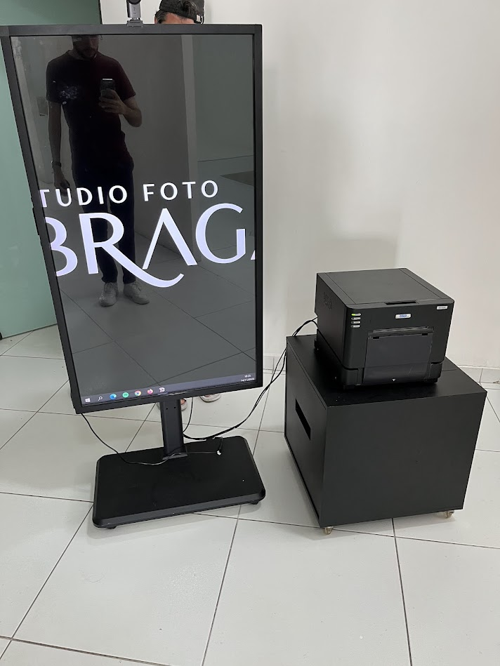
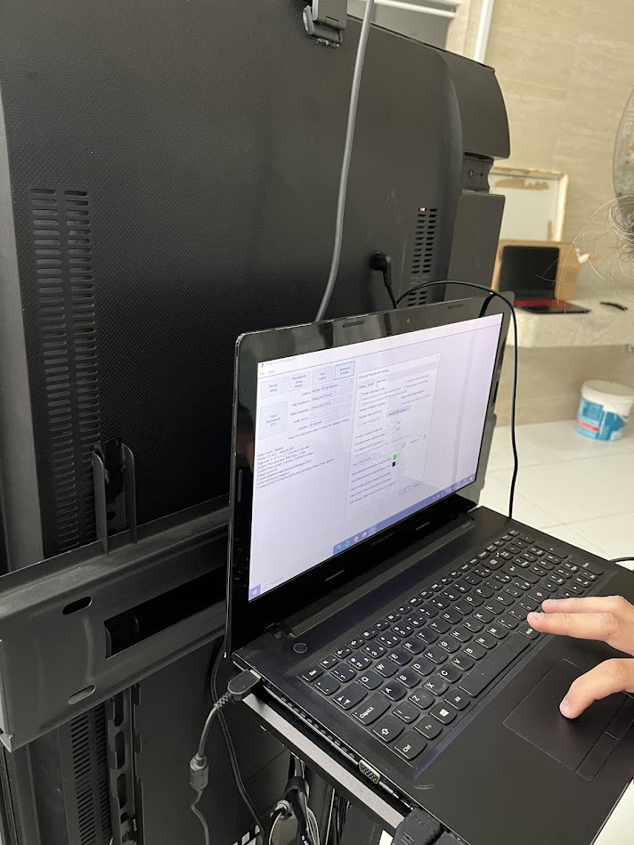
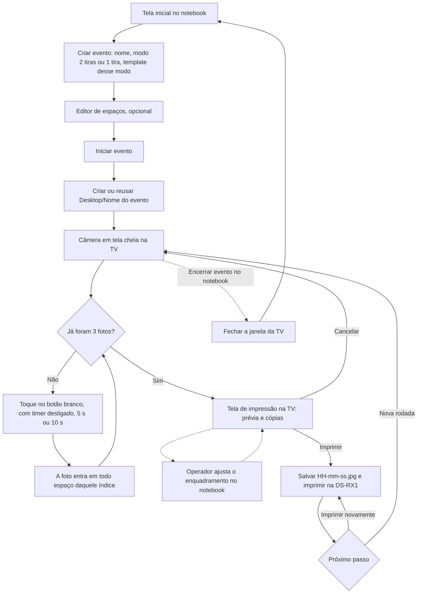
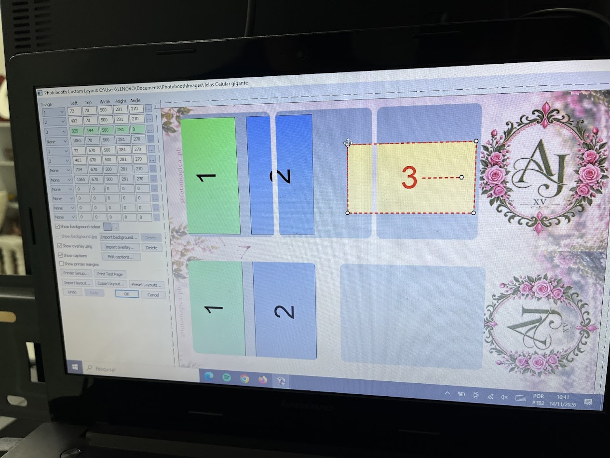
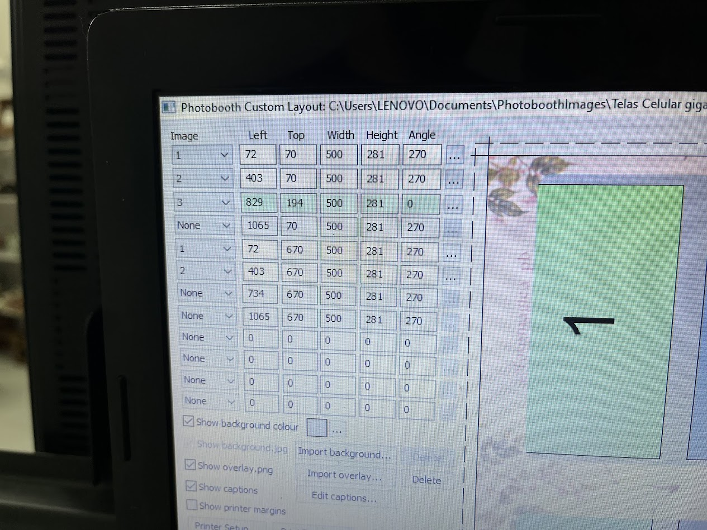
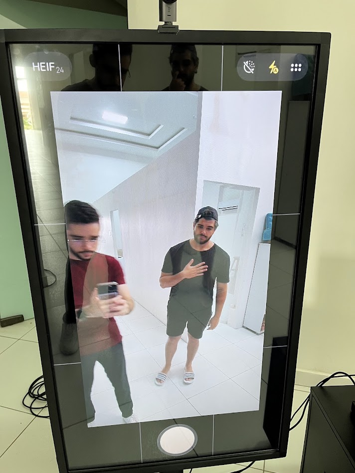
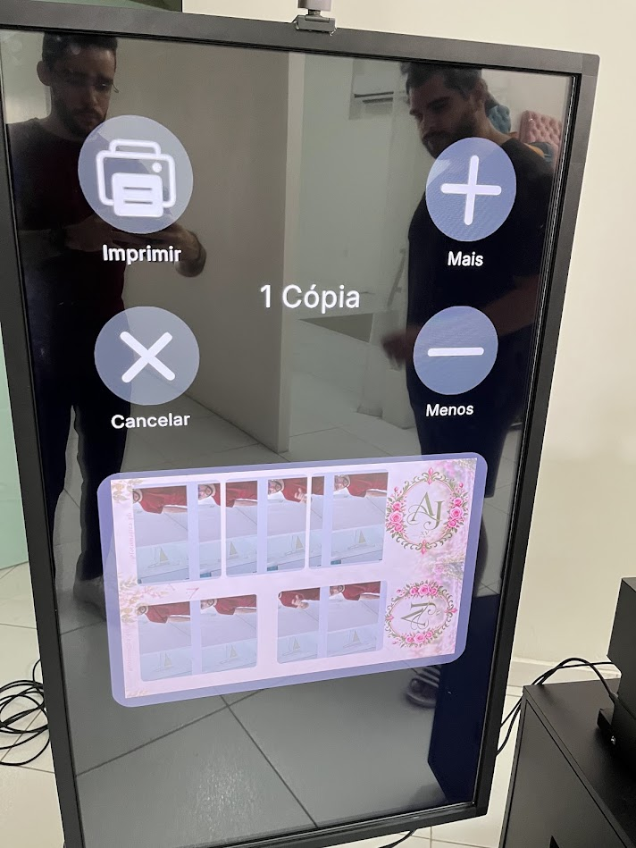
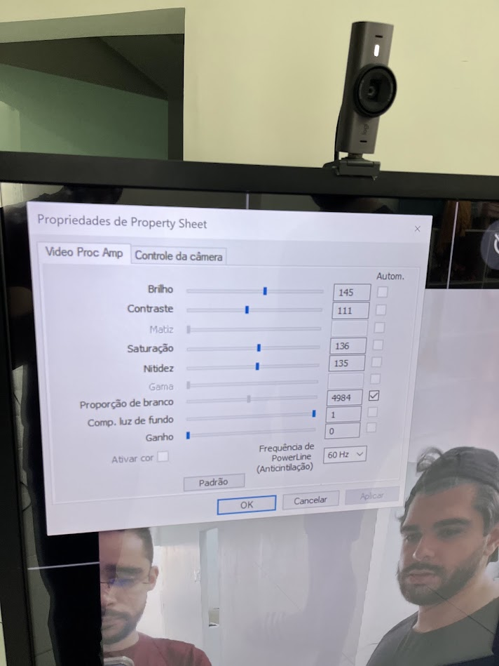
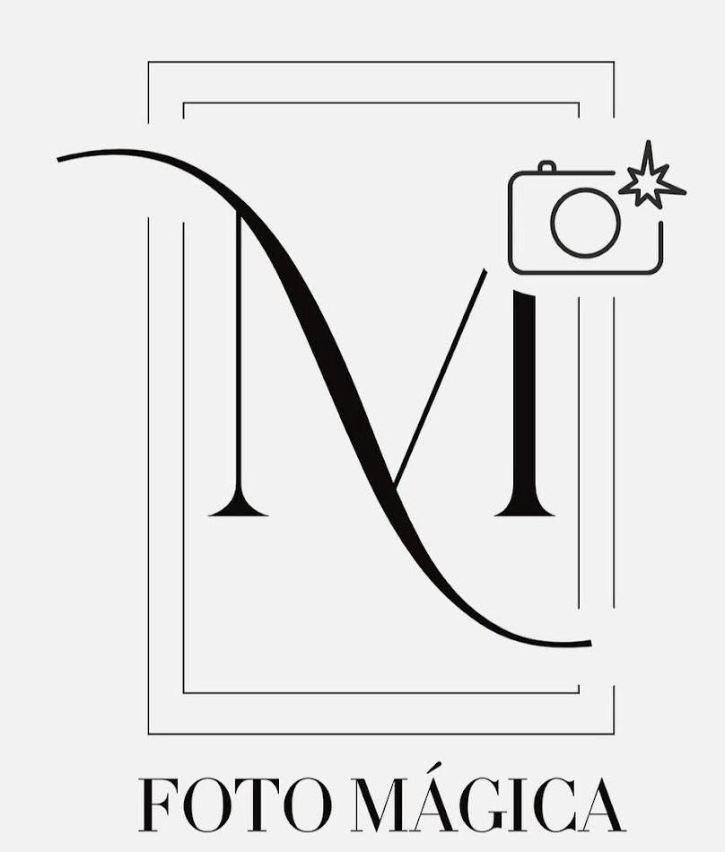

# Foto Mágica 2.0 — Requisitos do produto

> Estado: base para revisão · Dono: Vinicius (@ovinidev) · Idioma da interface: pt-BR
>
> Este documento diz o que o app faz e como se prova que faz. O como técnico e o visual estão em [DESIGN.md](./DESIGN.md). Se os dois discordarem, este arquivo vence e o DESIGN é atualizado no mesmo PR.

## 1. Produto

O Foto Mágica é um photobooth de festa. Uma TV fica em pé, com touch e uma webcam no topo. Os convidados tiram 3 fotos. O app encaixa essas fotos num template do evento e manda a folha para a DNP DS-RX1. No modo padrão a impressora corta a folha em duas tiras. No outro modo a folha 6×4 sai inteira, sem corte, com as três fotos ocupando a folha.

Hoje isso roda no Webcam Photobooth. O app novo mantém o ritmo da fila (chegar, posar, três toques, imprimir) e troca o que trava, o que pede configuração no meio da festa e o que o operador tem de ligar na mão na impressora.

## 2. Personas

### Operador

É quem conduz a festa, no notebook. Importa o template, acerta os espaços uma vez, posiciona as pessoas e dispara ou corrige o enquadramento quando um grupo ficou cortado. Não é desenvolvedor. No meio da fila não abre propriedade de impressora, não caça arquivo e não espera um diálogo do Windows.

O sucesso dele é: criar o evento em poucos campos, ver a montagem crescer a cada foto, corrigir um enquadramento sem refazer a rodada, e imprimir de novo uma montagem que já saiu.

### Convidados

São o grupo na frente da TV. Usam o dedo, muitas vezes vários ao mesmo tempo, com pressa e pouca familiaridade. Precisam se ver como num espelho, entender que são 3 fotos, e acertar um botão grande. Não escolhem template, não movem espaço e não veem o sistema de arquivos.

O sucesso deles é: achar o botão branco, esperar a contagem quando ela existe, e reconhecer a tira na prévia antes de imprimir.

## 3. Hardware e ambiente

| Item | Detalhe |
| --- | --- |
| Computador | Notebook com Windows 10 ou 11. Janela do operador |
| TV | Samsung UN49MU6120, 49", em retrato, moldura touch, HDMI como segundo monitor. A janela da câmera é desenhada para 1080×1920 |
| Webcam | Logitech MX Brio 705 for Business, até 3840×2160, presa na horizontal no topo da TV. O retrato é rotação de software de 90° |
| Impressora | DNP DS-RX1, 300×300 DPI, papel 6×4" (152×102 mm), corte de 2" que gera duas tiras |
| Arquivo de impressão | 1844×1240 px. Margem de 22 px nas laterais e 20 px em cima e embaixo |
| Rede | Não há internet na festa. Captura, arquivo e impressão funcionam offline |

A etiqueta da TV e o diálogo atual da impressora estão nas figuras 3 e 10, no [DESIGN.md](./DESIGN.md).

## 4. Decisões já tomadas

Estas decisões vieram do dono do produto. A implementação segue isto, sem reabrir.

1. **Template de duas tiras.** A tira de cima leva as fotos 1, 2 e 3 na vertical (Angle 270). A tira de baixo leva as fotos 1 e 2 na horizontal (Angle 0). Os números da tabela do briefing são aproximados: foram mexidos na demonstração e não medem os quadrados cinzas. O Cima 3 com Angle 0 e Top 194 é sobra dessa demo. Os espaços ficam dentro dos quadrados cinzas e continuam ajustáveis no editor. Esse é o layout do modo com corte.
2. **Câmera.** A Logitech fica montada na horizontal, no topo da TV, sem giro físico. A rotação de 90° para retrato é feita por software, como no Webcam Photobooth. O sentido mora na constante `CAMERA_ROTATION_DEG`, valor inicial 90. A imagem de trabalho é retrato. Nos espaços horizontais o encaixe padrão corta o centro. O operador ajusta o enquadramento (mover, girar, zoom) no notebook.
3. **Impressão.** Antes de iniciar o evento o operador escolhe o modo. **2 tiras** é o padrão: corte de 2" ligado e o layout de cinco espaços. **1 tira** desliga o corte e usa um layout próprio de três espaços, fotos 1, 2 e 3, cobrindo a folha 6×4 inteira (1844×1240). Não é meia folha em branco e não é papel 6×2. Os dois layouts ficam salvos e os dois se editam no editor.
4. **Driver.** Corte de 2" e os estados sem papel, sem ribbon e desligada usam o que o driver do Windows expuser. O teste no aparelho é do dono. O código de impressão fica isolado, com um modo simulado que os testes usam no lugar do hardware.
5. **Tela inicial.** Só cria evento novo. Não lista eventos antigos.
6. **Assinatura.** O cliente tem certificado de assinatura de código para Windows. O CI assina quando os secrets existem (por exemplo `CSC_LINK` e `CSC_KEY_PASSWORD`) e gera o instalador mesmo quando não existem.
7. **Ajustes da webcam.** Brilho, contraste, saturação, nitidez, balanço de branco e ganho entram por constraints do dispositivo. Compensação de luz de fundo só aparece se o dispositivo expuser essa capability.
8. **Pasta do evento.** `Desktop\<Nome do evento>`, com `app.getPath('desktop')`. O arquivo salvo é só a montagem JPG, nomeada `HH-mm-ss.jpg`.
9. **Cópias.** Mais para em 10. Menos para em 1. Aprovado pelo dono.
10. **Queda no meio da rodada.** Até o Imprimir, a rodada vive na memória. Se o processo cair antes, as três fotos se perdem. Não há rascunho em disco, porque a pasta do evento só recebe a montagem. Aprovado pelo dono.
11. **Snap do editor.** O espaço encosta nas bordas e nos centros. O giro encosta em 0°, 90°, 180° e 270° dentro de 4°. Alt desliga o snap. Aprovado pelo dono.
12. **Release.** Cada push na `main` gera o instalador. A GitHub Release, que o electron-updater enxerga, sai quando a versão do `package.json` ainda não foi publicada. Aprovado pelo dono.

## 5. Fluxo

Cancelar não grava arquivo: a montagem só existe em disco no Imprimir. Imprimir novamente reenvia esse mesmo JPG e não cria outro arquivo (RF13).

## 6. Telas

### 6.1 Criar evento (notebook)

Campos: nome do evento, o modo da festa (2 tiras, padrão, ou 1 tira) e importar o template PNG ou JPG desse modo.

O app lê o tamanho do arquivo. Com 1844×1240, o template é aceito para o modo selecionado. Com outro tamanho, a tela mostra a largura e a altura encontradas e o botão Iniciar evento fica desligado.

Suposição, até o cliente dizer o contrário: cada modo tem o seu fundo. A arte de duas tiras e a arte de três fotos na folha inteira são desenhos diferentes, então o arquivo importado grava no modo que está selecionado. Iniciar usa o template desse modo. O outro modo conserva o arquivo dele. O mesmo arquivo pode ser importado nos dois, e mesmo assim ficam gravados separados.

Há um caminho para o editor de espaços antes de iniciar. Iniciar evento cria a pasta no Desktop e abre a câmera na TV.

A tela não mostra eventos anteriores.

### 6.2 Editor de espaços (notebook)

O editor guarda dois layouts. Um seletor troca qual está na tela. Editar um não altera o outro. Os dois sobrevivem ao reinício e valem para todos os eventos daquele modo.

**2 tiras** tem cinco espaços e a guia da linha de corte:

| Espaço | Foto padrão | Orientação | Angle |
| --- | --- | --- | --- |
| Cima 1 | 1 | vertical | 270 |
| Cima 2 | 2 | vertical | 270 |
| Cima 3 | 3 | vertical | 270 |
| Baixo 1 | 1 | horizontal | 0 |
| Baixo 2 | 2 | horizontal | 0 |

**1 tira** tem três espaços, fotos 1, 2 e 3, sem guia de corte. O seed abaixo cobre a folha e está pendente de validação.

O painel do espaço selecionado edita a foto (1, 2 ou 3), Left, Top, Width, Height e Angle. No preview, o espaço selecionado tem borda vermelha tracejada, 8 alças de redimensionar e uma alça de rotação abaixo do centro inferior. Left, Top e Angle mudam ao vivo durante o arraste e o giro. Width e Height mudam ao vivo durante o redimensionamento.

O editor do app atual trava nesse gesto. O novo mantém o ponteiro fluido e encosta o espaço nas bordas e nos centros (tela, margens, os outros espaços e, só no layout de 2 tiras, a linha de corte).

Cada layout salva no computador e vale para todos os eventos daquele modo. Trocar o template não zera o layout. O operador ajusta de novo se os quadrados cinzas de um tema não coincidirem com o layout salvo.

#### Números da demonstração, e o seed

O app atual guarda uma grade de passo 331: colunas em Left 72, 403, 734 e 1065, linhas em Top 70 e 670. Várias células estavam em `None`. O Cima 3 foi arrastado para fora da terceira coluna.

| Espaço | Foto | Left | Top | Width | Height | Angle | Leitura |
| --- | --- | --- | --- | --- | --- | --- | --- |
| Cima 1 | 1 | 72 | 70 | 500 | 281 | 270 | Já caía no quadrado da esquerda |
| Cima 2 | 2 | 403 | 70 | 500 | 281 | 270 | Já caía no quadrado do meio |
| Cima 3 | 3 | 829 | 194 | 500 | 281 | 0 | Sobra da demo. Não entra no seed |
| Baixo 1 | 1 | 72 | 670 | 500 | 281 | 0 | Cruza o Baixo 2 |
| Baixo 2 | 2 | 403 | 670 | 500 | 281 | 0 | Cruza o Baixo 1 |

Seed de 2 tiras na primeira execução, já sem o ângulo errado e sem a sobreposição de baixo:

| Espaço | Foto | Left | Top | Width | Height | Angle |
| --- | --- | --- | --- | --- | --- | --- |
| Cima 1 | 1 | 72 | 70 | 500 | 281 | 270 |
| Cima 2 | 2 | 403 | 70 | 500 | 281 | 270 |
| Cima 3 | 3 | 734 | 70 | 500 | 281 | 270 |
| Baixo 1 | 1 | 72 | 670 | 500 | 281 | 0 |
| Baixo 2 | 2 | 620 | 670 | 500 | 281 | 0 |

Esse seed de 2 tiras é a suposição de trabalho. As medidas dos quadrados cinzas estão pendentes do cliente; até lá o app grava estes números e o operador ainda pode arrastar cada espaço. 620 existe para a largura 500 não cruzar o espaço que começa em 72. A linha de corte usada junto com esse seed é y = 620, também pendente do cliente.

#### Seed do modo 1 tira

Três retratos lado a lado, Angle 0, para a folha inteira ficar ocupada. As margens de 42 px nas laterais e 40 px em cima e embaixo ficam dentro da área de impressão (22 e 20). O vão entre espaços é 40 px. Left e Top são o canto visível, porque o ângulo é 0.

| Espaço | Foto | Left | Top | Width | Height | Angle |
| --- | --- | --- | --- | --- | --- | --- |
| 1 | 1 | 42 | 40 | 560 | 1160 | 0 |
| 2 | 2 | 642 | 40 | 560 | 1160 | 0 |
| 3 | 3 | 1242 | 40 | 560 | 1160 | 0 |

42 + 560 = 602, e o próximo começa em 642. 1242 + 560 = 1802, e sobram 42 px até 1844. 40 + 1160 = 1200, e sobram 40 px até 1240. Nenhum espaço deixa uma metade da folha vazia. Estes números não foram medidos numa arte: estão pendentes de validação.

### 6.3 Evento no notebook

Enquanto a festa roda, o notebook mostra:

- A prévia da montagem da rodada, preenchida conforme as fotos entram
- O enquadramento de cada espaço: mover, girar e zoom da foto dentro do espaço, sem mover o espaço
- A câmera ao vivo, sem a moldura de iPhone, no retrato que a TV mostra. No modo 2 tiras, uma máscara mostra o corte horizontal da tira de baixo. No modo 1 tira a máscara segue o espaço retrato da próxima foto
- Um botão de tirar foto, equivalente ao botão branco da TV
- A galeria das montagens da pasta do evento
- O estado da impressora
- Encerrar evento, que fecha a TV e volta à tela inicial

O editor de espaços não abre com evento em andamento. Para mudar Left/Top/Angle o operador encerra a festa.

### 6.4 Câmera (TV)

Abre em tela cheia no monitor da TV assim que o evento começa. O visual segue a câmera atual do iPhone: barras de vidro fosco, botão branco, miniatura da galeria. Some o seletor VIDEO/PHOTO/PORTRAIT e o botão de câmera frontal.

- Imagem ao vivo espelhada. A pessoa se vê como num espelho, e o JPG salvo mostra exatamente isso
- Botão branco central, embaixo. Cada toque tira uma foto. São três toques por rodada. Um contador marca 1/3, 2/3 e 3/3
- Temporizador: desligado, 5 s ou 10 s, com contagem grande
- Miniatura da última montagem no canto inferior esquerdo. O toque abre a galeria
- No lugar do flash, o ícone de ajustes da webcam
- Grade de terços, ligada ou desligada
- Alvos de toque de pelo menos 64 px

### 6.5 Impressão (TV)

Depois da terceira foto a TV mostra a prévia da folha, Imprimir, Cancelar, Mais e Menos. As cópias começam em 1 e param em 10. Uma cópia é sempre uma folha 6×4. No modo 2 tiras a faca corta essa folha em duas. No modo 1 tira a folha sai inteira, sem corte, com as três fotos no layout desse modo.

Cancelar descarta a rodada e volta à câmera, sem arquivo. Imprimir grava o JPG e envia à DS-RX1. Em seguida a TV oferece Imprimir novamente e Nova rodada.

### 6.6 Galeria

Lista as montagens da pasta do evento. Abre pela miniatura na TV e pelo notebook. Tocar ou clicar abre em tela cheia. O menu de três pontos tem Imprimir novamente.

### 6.7 Ajustes da webcam

O painel pede brilho, contraste, saturação, nitidez, balanço de branco e ganho. A compensação de luz de fundo entra só quando a câmera anuncia essa capability. O mesmo painel abre na TV, no ícone de ajustes, e no notebook. Os dois gravam o mesmo estado.

O diálogo do Windows da figura 8 também mostra matiz, gama, “ativar cor” e frequência da rede. Esses controles não entram no app. Se a câmera expuser a frequência da rede, o app fixa 60 Hz e não desenha o controle.

## 7. Requisitos funcionais

Cada critério é verificável por teste de unidade, teste de componente ou E2E no Electron com impressora simulada e webcam de fixture. Onde o hardware real entra, o critério diz isso e o dono executa.

### RF01 — Criar evento com nome e template

Dado um nome válido, o modo 2 tiras ou 1 tira, e um PNG ou JPG de 1844×1240 importado nesse modo, a prévia mostra esse fundo e Iniciar evento fica disponível. O template do outro modo não muda.

Dado um arquivo de outro tamanho, a tela mostra as dimensões lidas e 1844×1240, e Iniciar evento permanece desligado. Não existe pasta no Desktop.

Dado nome vazio, só espaços, um nome reservado do Windows (`CON`, `PRN`, `AUX`, `NUL`, `COM1`…`COM9`, `LPT1`…`LPT9`) ou um nome com `\ / : * ? " < > |`, Iniciar evento permanece desligado.

### RF02 — Pasta no Desktop

Dado um evento iniciado com o nome `Aniversário AJ`, existe a pasta `Desktop\Aniversário AJ`. O caminho usa `app.getPath('desktop')`, não um Desktop hardcoded de um usuário.

Dado que a pasta já existe e contém `21-45-08.jpg`, iniciar de novo um evento com o mesmo nome reusa a pasta e mantém esse arquivo.

A pasta, depois de uma impressão, contém somente arquivos `HH-mm-ss.jpg` produzidos pelo app. O template e o JSON do evento ficam fora dela.

### RF03 — Editor dos dois layouts

Dado o seed de 2 tiras, os cinco espaços têm os valores dessa tabela, Cima 3 está em Angle 270, e os retângulos de Baixo 1 e Baixo 2 não se intersectam.

Dado o seed de 1 tira, existem três espaços, com fotos 1, 2 e 3 e Angle 0, nos números da tabela da seção 6.2. Eles ocupam a folha inteira, com os vãos dessa tabela, e não deixam uma metade em branco. Os números estão pendentes de validação.

Dado um arraste com o botão preso, Left e Top do painel mudam antes de soltar. Dado um giro, Angle muda antes de soltar. Dado um redimensionamento, Width e Height mudam antes de soltar. Durante o gesto não há escrita em disco.

Dado o espaço a 6 px de uma borda da folha, de um centro, da margem (22 / 1822 na horizontal, 20 / 1220 na vertical) ou da borda de outro espaço, o painel mostra o valor encostado ainda com o botão preso. No layout de 2 tiras, o mesmo vale para a linha de corte de trabalho (y = 620, pendente do cliente). No layout de 1 tira essa linha não é alvo. A 9 px, permanece onde o ponteiro deixou. A tolerância de 8 px está no DESIGN. Com Alt preso, o mesmo gesto a 6 px não encosta. O giro a 3° de 0, 90, 180 ou 270 encosta nesse ângulo; a 5° não encosta.

Dado os dois layouts salvos e o app reaberto, cada um volta com os seus números. Um evento em 2 tiras usa o layout de 2 tiras. Um evento em 1 tira usa o de 1 tira. Editar um não grava o outro.

Dado o painel, trocar a foto de um espaço para 1, 2 ou 3 persiste. O padrão de 2 tiras continua 1, 2, 3, 1, 2. O padrão de 1 tira continua 1, 2, 3.

### RF04 — Janela da câmera na TV

Dado um segundo monitor em retrato, iniciar o evento abre uma janela sem moldura, cobrindo esse monitor, e a janela do notebook continua na tela principal.

Dado só o notebook, o evento não abre a câmera e a tela explica que a TV não foi encontrada.

Dado um segundo monitor em paisagem, a tela avisa que a TV não está em retrato. O operador pode confirmar e abrir mesmo assim.

### RF05 — Ao vivo espelhado, arquivo igual

Dado um quadro de fixture com uma marca no lado esquerdo do sensor, a TV mostra essa marca no lado em que um espelho a colocaria, com a pessoa de pé. A câmera está na horizontal; quem põe a imagem em pé é `CAMERA_ROTATION_DEG` (inicial 90), a mesma constante no preview e no arquivo.

O JPG da montagem, aberto depois, mostra a mesma orientação e o mesmo espelhamento daquele quadro. Não há um caminho de preview e outro de arquivo.

### RF06 — Três fotos e contador

Dado o evento na câmera, o contador lê 1/3. Cada toque no botão branco, com o timer desligado, consome uma foto e avança o contador para 2/3 e 3/3. O quarto toque não tira foto: a TV já foi para a impressão.

O botão de tirar foto no notebook dispara a mesma captura, inclusive o timer se ele estiver armado.

Um toque durante a contagem ou no instante da captura não acrescenta uma foto extra.

### RF07 — Temporizador

Dado o timer em 5 s, o toque mostra 5, 4, 3, 2, 1 e só então captura. O mesmo vale para 10 s. Desligado, a captura é imediata.

Trocar o timer na TV troca o valor que o notebook mostra, e o inverso.

### RF08 — Encaixe automático

Dado o layout de 2 tiras, a foto 1 preenche Cima 1 e Baixo 1, a foto 2 preenche Cima 2 e Baixo 2, a foto 3 preenche Cima 3.

Dado o layout de 1 tira, a foto 1 preenche o espaço 1, a foto 2 o espaço 2 e a foto 3 o espaço 3. Não há segunda cópia da foto 1 nem da foto 2. A folha composta não tem uma metade branca.

Na montagem de teste, uma barra clara no topo do quadro de fixture aparece no topo de cada espaço. Nas três de cima do modo 2 tiras, e nos três espaços do modo 1 tira, o espaço é vertical. Nas duas de baixo do modo 2 tiras o espaço é horizontal e, com pan e zoom padrão, a barra continua no topo e as sobras cortadas são as do centro do retrato, em partes iguais acima e abaixo do que coube.

### RF09 — Enquadramento pelo operador

Dado um espaço já preenchido, no notebook o operador desloca, gira e dá zoom na foto sem alterar Left, Top, Width, Height ou Angle desse espaço.

O zoom mínimo é 1 (a foto continua cobrindo o espaço) e o máximo é 3. O pan não revela a borda do quadro: o espaço permanece coberto.

No modo 2 tiras, Cima 1 e Baixo 1 usam a mesma captura e guardam enquadramentos independentes. Ajustar um não move o outro. No modo 1 tira cada foto tem um espaço só.

A TV atualiza a prévia da impressão com esse enquadramento.

### RF10 — Tela de impressão

Depois da terceira foto a TV mostra a prévia, Imprimir, Cancelar, Mais e Menos, com o texto `1 Cópia`. Mais leva a 2, 3, até 10. Em 10, Mais fica desligado. Em 1, Menos fica desligado.

Cancelar volta à câmera com o contador em 1/3 e não cria arquivo na pasta do evento.

### RF11 — Impressão direta com corte de 2"

Dado o modo das duas tiras, Imprimir envia o JPG à impressora cujo nome contém `DS-RX1`, sem diálogo, com corte de 2" pedido ao driver, orientação retrato, 300 DPI e uma folha por cópia.

Dado o modo 1 tira, o JPEG é 1844×1240, com as três fotos compostas no layout desse modo e sem uma metade branca. O pedido é a folha 6×4 com o corte de 2" desligado. O ticket simulado registra `one-strip` e corte desligado. O modo 2 tiras registra `two-strips` e corte ligado.

Dado o modo simulado, Imprimir não abre diálogo e grava um ticket com o caminho do JPG, as cópias, o modo e o corte pedido.

Se o driver não aceitar o corte pedido (ligado nas 2 tiras, desligado na 1 tira), Imprimir não segue calado: a TV e o notebook mostram que o corte não pôde ser ajustado, e a folha não é dada como impressa.

### RF12 — Só a montagem, com a hora no nome

Dado um Imprimir às 21:45:08 hora local, a pasta do evento ganha `21-45-08.jpg`. O arquivo é JPEG, 1844×1240, com densidade 300 DPI.

Dado outro Imprimir no mesmo segundo, o segundo arquivo é `21-45-08-2.jpg`.

A pasta não ganha a foto 1, a foto 2 nem a foto 3 soltas.

### RF13 — De novo ou nova rodada

Depois de um Imprimir bem-sucedido, a TV mostra Imprimir novamente e Nova rodada.

Imprimir novamente manda outra vez o mesmo JPG, com a quantidade de cópias atual, e não cria outro arquivo.

Nova rodada volta à câmera em 1/3, com a montagem anterior só na galeria.

Se a impressão falha, o JPG permanece na pasta quando o arquivo já foi gravado, a rodada não é descartada, e a tela oferece tentar de novo.

### RF14 — Galeria

Dado dois JPG na pasta do evento, a miniatura da TV e a galeria do notebook listam os dois. Abrir um mostra a imagem em tela cheia. O menu de três pontos oferece Imprimir novamente, que reenvia aquele arquivo.

A lista não mostra arquivo que não seja a montagem JPG do app.

### RF15 — Ajustes da webcam

O painel oferece brilho, contraste, saturação, nitidez, balanço de branco e ganho, com os intervalos que a câmera anunciar. Um controle cuja capability não existe não é desenhado.

A compensação de luz de fundo aparece só quando a capability existe.

Dado um valor alterado e o app fechado e aberto, o valor reaplicado na câmera é o salvo.

Dado o modo de fixture, sem dispositivo, o painel abre com os controles persistidos e não lança erro.

### RF16 — Encerrar evento

Encerrar evento fecha a janela da TV, esquece a rodada que ainda não foi impressa e volta à tela inicial. A pasta e os JPG já gravados permanecem. O layout global permanece.

## 8. Requisitos não funcionais

### RNF01 — Stack

O app de produção é Electron + React + TypeScript e gera instalador Windows. O critério é o `pnpm dist` descrito no DESIGN, num runner `windows-latest`.

### RNF02 — Offline

Com a rede desligada, dá para criar evento, capturar, enquadrar, salvar o JPG e imprimir no modo simulado ou na impressora local. Nenhuma dessas ações mostra erro de rede.

### RNF03 — Duas telas fixas

A janela do operador é a do notebook. A da TV é tela cheia em retrato, desenhada para 1080×1920. Não há layout de celular nem breakpoint de site.

### RNF04 — Desempenho

A prévia ao vivo pede 30 fps à câmera. O quadro não passa pelo processo principal: a TV envia um ImageBitmap ao notebook por MessageChannel e descarta o frame se o anterior ainda não foi consumido. Um gesto de 60 movimentos no editor aplica o último sem escrita em disco e sem chamada ao processo principal. A montagem de uma rodada de fixture fica pronta em menos de 2 s no notebook de referência do dono; o teste automático usa um teto folgado de 5 s no CI para não acoplar o critério à carga do runner.

### RNF05 — Qualidade

A captura pede 3840×2160 e aceita o máximo que a câmera entregar se esse modo faltar. A montagem é 1844×1240 a 300 DPI.

### RNF06 — Interface

A janela do notebook é light mode, com os tokens do DESIGN, tipografia Inter empacotada (funciona offline) e a logo da seção 10. A TV usa o vidro fosco da câmera do iPhone, não o formulário claro do notebook. Não há tela de configurações no formato da figura 12.

### RNF07 — Toque na TV

Todo controle da TV tem caixa de toque de pelo menos 64×64 px, com folga visível entre vizinhos. O botão branco de captura é maior do que esse mínimo.

### RNF08 — Arquitetura

As pastas seguem o DESIGN §13, no mesmo desenho feature-based do PilatePay. Um import que atravessa o miolo de outra feature é erro de lint ou de revisão, não um atalho aceito.

### RNF09 — Build, release e atualização

Todo pull request roda typecheck, oxlint, testes unitários e E2E. Todo push na `main` faz o mesmo e gera o instalador Windows. Uma versão nova do `package.json` publica GitHub Release. O endereço estável da última versão é o asset `FotoMagica-Setup.exe` da release `latest`. O app, aberto sem evento em andamento e com rede, procura atualização pelo electron-updater. Sem rede, abre assim mesmo.

### RNF10 — Resiliência

Dado a webcam desconectada com uma ou duas fotos já feitas, essas fotos continuam na prévia, a TV mostra um aviso e segue aceitando toque. Reconectar permite a foto que falta.

Dado a impressora offline, sem papel ou sem ribbon, Imprimir não descarta a rodada e mostra qual dos três estados foi. Se o driver não informar ribbon ou papel, a mensagem diz que o driver não informou, em vez de inventar o estado.

A janela da TV não fica em modal que só um Alt+F4 derruba. Encerrar evento no notebook sempre a fecha.

### RNF11 — Memória local

Layout, ajustes de webcam e a impressora escolhida sobrevivem a fechar e abrir o app. Desinstalar não é exigido para limpar isso; o lugar é o `userData` do Electron.

### RNF12 — Identidade

O ícone do instalador, do atalho, da barra de tarefas e da janela é o símbolo (M, moldura dupla e câmera), sem a frase, nas medidas 16, 32, 48 e 256. A logo completa aparece na abertura, na tela de criar evento e no cabeçalho do notebook. A imagem ao vivo não carrega logo. A tela de impressão pode levar uma marca pequena fora da prévia da folha.

## 9. Fora de escopo

- Vídeo, modo retrato e câmera frontal
- A tela de configurações do app atual (escolher câmera num assistente, resolução, áudio, rotação manual). O app já sobe com rotação 90°, sem áudio e com a MX Brio quando ela está presente. Se houver mais de uma câmera e nenhuma com “MX Brio” no nome, o criar evento mostra a lista só nesse caso
- Salvar as fotos originais
- Conta de usuário, nuvem, pagamento, moldura animada, compartilhamento
- Matiz, gama e “ativar cor” da webcam
- Listar ou reabrir eventos antigos na tela inicial. Os JPG continuam na pasta do Desktop e o sistema de arquivos do Windows serve para isso
- Papel 6×2 e meia folha em branco. O modo 1 tira é a folha 6×4 inteira, sem corte, com três fotos
- macOS e Linux como alvo de produção. O CI pode exercitar lógica pura em Linux; o instalador é Windows

## 10. Identidade

A logo é preta: um M dentro de uma moldura dupla, uma câmera com brilho no canto superior direito e o texto FOTO MÁGICA. O arquivo do briefing tem fundo cinza (242, 242, 242).

O arquivo de trabalho transparente está em `assets/brand/logo.png`. O símbolo sem o texto, para ícone, está em `assets/brand/mark.png`. A pastilha clara opaca usada para o `.ico` (o traço preto some numa barra escura se o ícone for transparente) está em `assets/brand/icon.png`. Ainda falta um SVG do cliente para o 16 px ficar desenhado de propósito; até lá o ícone nasce do PNG.

## 11. Pendências e o que ainda falta confirmar

### Pendente do cliente

O app segue com a suposição atual até esses dados chegarem. Não bloqueiam a implementação.

1. **Quadrados cinzas do modo 2 tiras.** Não há coordenada medida da arte. O seed de cinco espaços da seção 6.2 é o que o app grava na primeira execução. O operador ainda arrasta cada espaço até cobrir o quadrado.
2. **Linha de corte.** A faca de 2" é tratada como y = 620 na folha de 1240 px, só no layout de 2 tiras. Um espaço que cruza essa linha gera aviso no editor. O valor troca quando o cliente passar a medida.
3. **Seed do modo 1 tira.** Os três espaços (42, 642 e 1242 por 560×1160, Angle 0) são um ponto de partida para cobrir a folha. Estão pendentes de validação. Não há arte medida para eles.
4. **Template por modo.** Suposição em vigor: cada modo guarda o seu fundo de 1844×1240, importado na tela de criar evento com aquele modo selecionado. Cai se o cliente disser que um único arquivo serve aos dois.

### Ainda em aberto

1. **Ribbon e papel.** Só entram os status que o spooler ou o driver expuserem. Status ausente vira “o driver não informou”, não um chute.
2. **Orientação Portrait.** O diálogo atual marca Portrait para um bitmap 1844×1240, que é mais largo do que alto. O app faz o mesmo e não gira o bitmap de novo. Uma folha de teste confirma que a tira sai em pé.
3. **Hora do arquivo.** É a hora local do Windows, não um fuso fixo.
4. **Logo.** O PNG transparente foi obtido retirando o fundo 242 do raster. Não é vetor. Um SVG do cliente substitui `logo.png` e `mark.png`.
5. **Câmera quando há várias.** Prefere o dispositivo cujo nome contém `MX Brio`. Sem ele, usa o primeiro e, se houver mais de um, mostra a escolha no criar evento.
