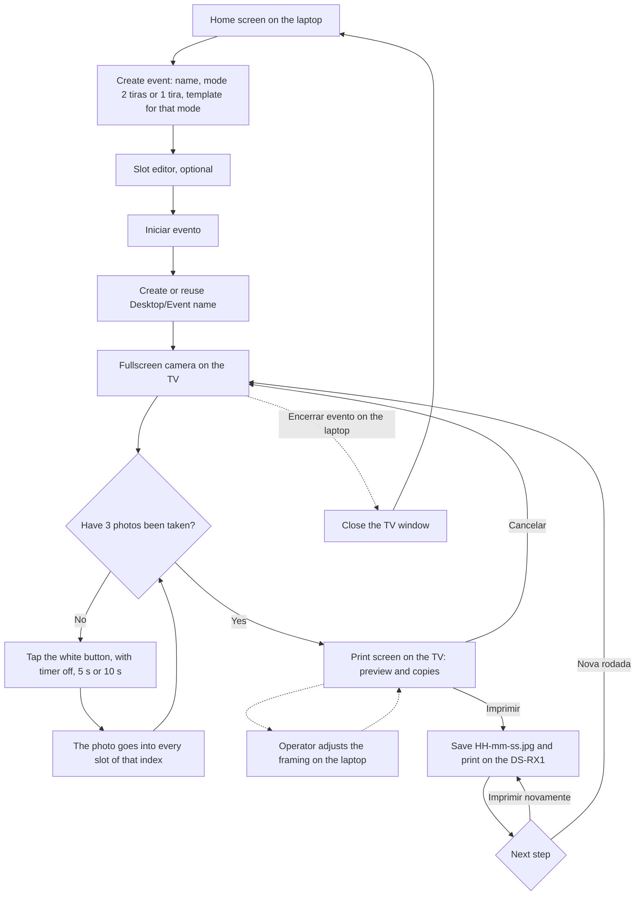
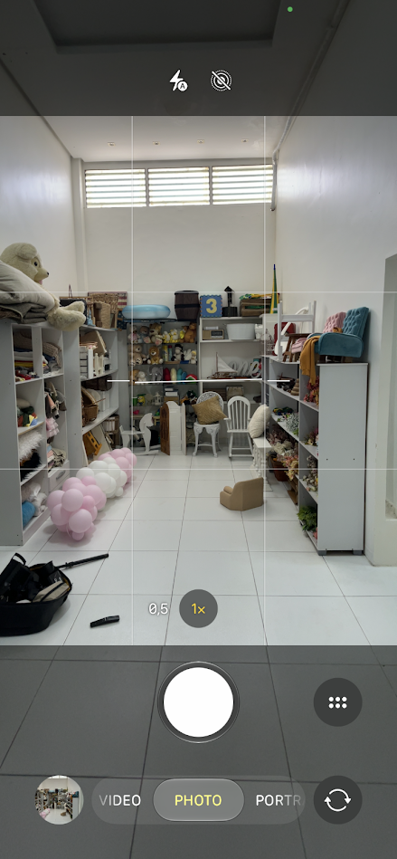
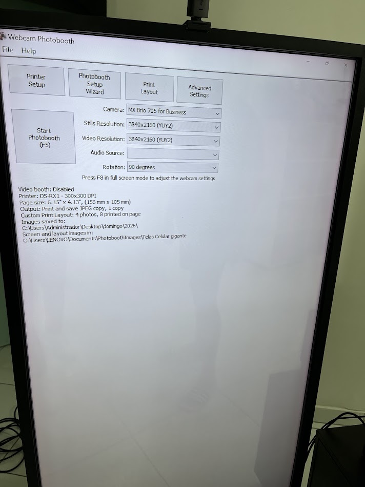

# Foto Mágica 2.0 — Product requirements

> Status: draft for review · Owner: Vinicius (@ovinidev) · UI language: pt-BR
>
> This document says what the app does and how we prove it does it. The technical and visual "how" is in [DESIGN.md](./DESIGN.md). If the two disagree, this file wins and DESIGN is updated in the same PR.
>
> **Language note.** This document is written in English. All end-user UI strings (button labels, messages, screen names the operator or guests see) stay in pt-BR and are quoted verbatim, for example `Iniciar evento`, `Imprimir`, `Cancelar`.

## 1. Product

Foto Mágica is a party photobooth. A TV stands upright, with touch and a webcam on top. Guests take 3 photos. The app fits those photos into the event template and sends the sheet to the DNP DS-RX1. In the default mode the printer cuts the sheet into two strips. In the other mode the 6×4 sheet comes out whole, uncut, with the three photos filling the sheet.

Today this runs on Webcam Photobooth. The new app keeps the rhythm of the queue (arrive, pose, three taps, print) and replaces what freezes, what needs configuration in the middle of the party, and what the operator has to switch on by hand in the printer.

## 2. Personas

### Operator

The person who runs the party, on the laptop. Imports the template, adjusts the slots once, positions people, and triggers or fixes the framing when a group was cropped. Not a developer. In the middle of the queue they do not open printer properties, do not hunt for files and do not wait for a Windows dialog.

Their success is: creating the event in a few fields, watching the montage grow with each photo, fixing a framing without redoing the round, and reprinting a montage that already came out.

### Guests

The group in front of the TV. They use a finger, often several at once, in a hurry and with little familiarity. They need to see themselves as in a mirror, understand that there are 3 photos, and hit one big button. They do not choose a template, do not move slots and do not see the file system.

Their success is: finding the white button, waiting for the countdown when there is one, and recognizing the strip in the preview before printing.

## 3. Hardware and environment

| Item | Detail |
| --- | --- |
| Computer | Laptop with Windows 10 or 11. Operator window |
| TV | Samsung UN49MU6120, 49", portrait, touch frame, HDMI as second monitor. The camera window is designed for 1080×1920 |
| Webcam | Logitech MX Brio 705 for Business, used at 1920×1080 (not 4K in practice), mounted horizontally on top of the TV. Portrait is a 90° software rotation |
| Printer | DNP DS-RX1, 300×300 DPI, 6×4" paper (152×102 mm), 2" cut that produces two strips |
| Print file | 1844×1240 px. Margin of 22 px on the sides and 20 px top and bottom |
| Network | There is no internet at the party. Capture, file and printing work offline |

The TV label and the printer's current dialog are in figures 3 and 10, in [DESIGN.md](./DESIGN.md).

## 4. Decisions already made

These decisions came from the product owner. The implementation follows them, without reopening.

1. **Two-strip template.** The top strip carries photos 1, 2 and 3 vertically (Angle 270). The bottom strip carries photos 1 and 2 horizontally (Angle 0). The numbers in the briefing table are approximate: they were moved around in the demonstration and do not measure the photo boxes. Cima 3 with Angle 0 and Top 194 is a leftover of that demo. The seed is the client's measured 2 tiras artwork (section 6.2): the owner confirmed that the photo boxes are always in those positions and only the background art changes between events. The slots remain adjustable in the editor. This is the layout of the cut mode.
2. **Camera.** The Logitech is mounted horizontally, on top of the TV, with no physical rotation. The 90° rotation to portrait is done in software, as in Webcam Photobooth. The direction lives in the constant `CAMERA_ROTATION_DEG`, initial value 90. The working image is portrait. In horizontal slots the default fit crops the center. The operator adjusts the framing (move, rotate, zoom) on the laptop.
3. **Printing.** Before starting the event the operator chooses the mode. **2 tiras** (two strips) is the default: 2" cut on and the five-slot layout. **1 tira** (one strip) turns the cut off and uses its own three-slot layout, photos 1, 2 and 3, covering the whole 6×4 sheet (1844×1240). It is not a half blank sheet and not 6×2 paper. Both layouts are saved and both are edited in the editor.
4. **Driver.** The 2" cut and the out-of-paper, out-of-ribbon and powered-off states use whatever the Windows driver exposes. Testing on the device is up to the owner. The print code is isolated, with a simulated mode that tests use in place of the hardware.
5. **Home screen.** It only creates a new event. It does not list old events.
6. **Signing.** The client has a code-signing certificate for Windows. CI signs when the secrets exist (for example `CSC_LINK` and `CSC_KEY_PASSWORD`) and produces the installer even when they do not.
7. **Webcam adjustments.** Brightness, contrast, saturation, sharpness, white balance and gain go through device constraints. Backlight compensation only appears if the device exposes that capability.
8. **Event folder.** `Desktop\<Event name>`, using `app.getPath('desktop')`. The saved file is only the JPG montage, named `HH-mm-ss.jpg`.
9. **Copies.** `Mais` stops at 10. `Menos` stops at 1. Approved by the owner.
10. **Crash mid-round.** Until `Imprimir`, the round lives in memory. If the process crashes before that, the three photos are lost. There is no draft on disk, because the event folder only receives the montage. Approved by the owner.
11. **Editor snap.** The slot snaps to edges and centers. Rotation snaps to 0°, 90°, 180° and 270° within 4°. Alt turns snap off. Approved by the owner.
12. **Release.** Every push to `main` produces the installer. The GitHub Release, which electron-updater sees, is published when the `package.json` version has not been published yet. Approved by the owner.

## 5. Flow

`Cancelar` does not write a file: the montage only exists on disk at `Imprimir`. `Imprimir novamente` resends that same JPG and does not create another file (RF13).

## 6. Screens

### 6.1 Create event (laptop)

Fields: event name, the party mode (2 tiras, default, or 1 tira) and import the PNG or JPG template for that mode.

The client's background art usually comes **without** the photo boxes, often plain white. The template is therefore optional: with none imported for the selected mode, the preview shows a plain white 1844×1240 sheet with the standard boxes in gray, the line under it reads `Fundo branco (padrão) · 1844 × 1240 px`, and `Iniciar evento` is available. The event then composes on that white sheet, with each photo in its box and the boxes' rounded corners.

The app reads the file size. At 1844×1240, the template is accepted for the selected mode. At any other size, the screen shows the width and height found and the `Iniciar evento` button is disabled. The importer takes PNG and JPEG only. A PDF (the client's artwork comes from Canva as PDF) is recognized and answered with `Este arquivo é um PDF. Exporte o template como PNG ou JPG de 1844 × 1240 px e importe de novo.`; rendering PDFs inside the app is an open question (section 11).

Assumption, until the client says otherwise: each mode has its own background. The two-strip art and the three-photo full-sheet art are different drawings, so the imported file is stored under the mode that is selected. Starting uses the template of that mode. The other mode keeps its own file. The same file can be imported into both, and they are still stored separately.

There is a path to the slot editor before starting: it opens by itself as soon as a template is accepted, on the layout of the selected mode, and again from the `Editar posições das fotos` button under the template. It opens over the form, which keeps the name and mode already filled in. `Iniciar evento` creates the folder on the Desktop and opens the camera on the TV.

The screen does not show previous events.

### 6.2 Slot editor (laptop)

The editor holds two layouts. A selector switches which one is on screen. Editing one does not change the other. Both survive a restart and apply to all events of that mode.

**2 tiras** has five slots and the cut-line guide:

| Slot | Default photo | Orientation | Angle |
| --- | --- | --- | --- |
| Cima 1 | 1 | vertical | 270 |
| Cima 2 | 2 | vertical | 270 |
| Cima 3 | 3 | vertical | 270 |
| Baixo 1 | 1 | horizontal | 0 |
| Baixo 2 | 2 | horizontal | 0 |

(The slot names Cima = top and Baixo = bottom are editor UI labels and stay in pt-BR.)

**1 tira** has three slots, photos 1, 2 and 3, with no cut guide. The seed below covers the sheet and is pending validation.

The template of that mode is the background, at the real sheet proportion (1844×1240), or the plain white sheet when there is none. Over it, under the cards, the editor always draws the mode's **standard boxes** as gray rounded rectangles: in 2 tiras the client's measured boxes (three portrait on top, two landscape below), in 1 tira its three portrait boxes. They come from the seed, not from the artwork, and do not move with the cards, so the operator sees where the photos go even when the art has no boxes. Each slot is a colored card with its photo number, as in the current app: green 1, blue 2, yellow 3. This is how the operator sees and assigns which webcam photo goes into which gray square.

The numbers panel on the left is a table with one row per slot, in the current app's order: Image, Left, Top, Width, Height, Angle. Image is the photo (1, 2 or 3) or `Nenhuma`, which leaves the slot empty on the montage (the template shows there). Typing a number moves the card while typing; Enter or leaving the field saves it. Clicking a card or a row selects that slot. In the preview, the selected slot has a dashed red border, 8 resize handles and a rotation handle below the bottom center. Left, Top and Angle change live during drag and rotation. Width and Height change live during resizing.

The current app's editor freezes during this gesture. The new one keeps the pointer fluid and snaps the slot to edges and centers (screen, margins, the other slots and, only in the 2-strip layout, the cut line).

In 2 tiras, a slot that crosses the cut line shows a warning under the preview; it does not block saving. `Desfazer` and `Refazer` (also Ctrl+Z and Ctrl+Y) step through the changes of the layout on screen, and `Restaurar padrão` puts back the seed of that mode, as one more undoable step. `Concluir` closes the editor; every change is already saved.

Each layout is saved on the computer and applies to all events of that mode. Changing the template does not reset the layout. The operator adjusts again if the gray squares of a theme do not match the saved layout.

#### Demonstration numbers (history)

The current app stores a grid with a step of 331: columns at Left 72, 403, 734 and 1065, rows at Top 70 and 670. Several cells were `None`. Cima 3 was dragged out of the third column.

| Slot | Photo | Left | Top | Width | Height | Angle | Reading |
| --- | --- | --- | --- | --- | --- | --- | --- |
| Cima 1 | 1 | 72 | 70 | 500 | 281 | 270 | Already fell in the left square |
| Cima 2 | 2 | 403 | 70 | 500 | 281 | 270 | Already fell in the middle square |
| Cima 3 | 3 | 829 | 194 | 500 | 281 | 0 | Demo leftover. Not in the seed |
| Baixo 1 | 1 | 72 | 670 | 500 | 281 | 0 | Overlaps Baixo 2 |
| Baixo 2 | 2 | 403 | 670 | 500 | 281 | 0 | Overlaps Baixo 1 |

#### Two-strip seed: the client's photo boxes

The client sent the real 2 tiras artwork (Canva PDF "Layout . 21.11.26", rendered at 1844×1240). Its photo boxes are black rounded rectangles. The owner fixed them: **the boxes are always in these positions; only the background art changes between events.** Measured visible rectangles on the sheet:

| Box | Photo | Visible left | Visible top | Visible width | Visible height |
| --- | --- | --- | --- | --- | --- |
| Cima 1 | 1 | 121 | 44 | 356 | 532 |
| Cima 2 | 2 | 533 | 44 | 356 | 532 |
| Cima 3 | 3 | 944 | 44 | 356 | 532 |
| Baixo 1 | 1 | 63 | 733 | 600 | 402 |
| Baixo 2 | 2 | 709 | 733 | 600 | 402 |

The boxes' right edge is anti-aliased: one column just past the measured width is about 35% black, so the boxes are really about 356.35 px (and 600.35 px) wide. The seed therefore bleeds 1 px past the left and right edges; the centers do not move and the numbers stay integers. The editor's Left/Top/Width/Height are the box before rotation, turned around its center (DESIGN §6). A top box at Angle 270 is therefore Width 532 × Height 358 around the same center: Left = 121 + 178 − 266 = 33, Top = 44 + 266 − 179 = 131. The two-strip seed on first run and after `Restaurar padrão`:

| Slot | Photo | Left | Top | Width | Height | Angle | Corner radius |
| --- | --- | --- | --- | --- | --- | --- | --- |
| Cima 1 | 1 | 33 | 131 | 532 | 358 | 270 | 30 |
| Cima 2 | 2 | 445 | 131 | 532 | 358 | 270 | 30 |
| Cima 3 | 3 | 856 | 131 | 532 | 358 | 270 | 30 |
| Baixo 1 | 1 | 62 | 733 | 602 | 402 | 0 | 30 |
| Baixo 2 | 2 | 708 | 733 | 602 | 402 | 0 | 30 |

The black boxes have rounded corners of about 33 px (31 to 35 measured). The photos are clipped to a rounded rectangle of 30 px, just under the tightest corner, so no black of the artwork shows and the photo corner reaches past the black by at most about 2 px of white (DESIGN §6). The top strip ends at y = 576 and the bottom one starts at 733: the working cut line y = 620 falls in that gap, so no seed slot crosses it. A computer that already saved a 2-strip layout keeps it; `Restaurar padrão` brings this seed.

#### One-strip mode seed

Three portraits side by side, Angle 0, so the whole sheet is filled, with the same 30 px rounded corners as the 2-strip boxes. The 42 px side margins and 40 px top and bottom margins sit inside the print area (22 and 20). The gap between slots is 40 px. Left and Top are the visible corner, because the angle is 0.

| Slot | Photo | Left | Top | Width | Height | Angle |
| --- | --- | --- | --- | --- | --- | --- |
| 1 | 1 | 42 | 40 | 560 | 1160 | 0 |
| 2 | 2 | 642 | 40 | 560 | 1160 | 0 |
| 3 | 3 | 1242 | 40 | 560 | 1160 | 0 |

42 + 560 = 602, and the next one starts at 642. 1242 + 560 = 1802, which leaves 42 px up to 1844. 40 + 1160 = 1200, which leaves 40 px up to 1240. No slot leaves half the sheet empty. These numbers were not measured on any artwork: they are pending validation.

### 6.3 Event on the laptop

While the party runs, the laptop shows:

- The round's montage preview, filled in as photos come in
- The framing of each slot: move, rotate and zoom of the photo inside the slot, without moving the slot
- The live camera, without the iPhone frame, in the portrait the TV shows. In 2 tiras mode, a mask shows the horizontal crop of the bottom strip. In 1 tira mode the mask follows the portrait slot of the next photo
- A take-photo button, equivalent to the white button on the TV
- The gallery of montages in the event folder
- The printer status
- `Encerrar evento`, which closes the TV and returns to the home screen

The slot editor does not open while an event is in progress. To change Left/Top/Angle the operator ends the party.

### 6.4 Camera (TV)

Opens fullscreen on the TV monitor as soon as the event starts. The look follows the current iPhone camera: frosted-glass bars, white button, gallery thumbnail. The VIDEO/PHOTO/PORTRAIT selector and the front-camera button go away.

- Live image mirrored. The person sees themselves as in a mirror, and the saved JPG shows exactly that
- White button, bottom center. Each tap takes a photo. Three taps per round. A counter shows 1/3, 2/3 and 3/3
- Timer: off, 5 s or 10 s, with a large countdown
- Thumbnail of the last montage in the bottom-left corner. Tapping it opens the gallery
- In place of the flash, the webcam adjustments icon
- Rule-of-thirds grid, on or off
- Touch targets of at least 64 px

### 6.5 Printing (TV)

After the third photo the TV shows the sheet preview, `Imprimir`, `Cancelar`, `Mais` and `Menos`. Copies start at 1 and stop at 10. One copy is always one 6×4 sheet. In 2 tiras mode the blade cuts that sheet in two. In 1 tira mode the sheet comes out whole, uncut, with the three photos in that mode's layout.

`Cancelar` discards the round and returns to the camera, with no file. `Imprimir` writes the JPG and sends it to the DS-RX1. Then the TV offers `Imprimir novamente` and `Nova rodada`.

### 6.6 Gallery

Lists the montages in the event folder. Opens from the thumbnail on the TV and from the laptop. Tapping or clicking opens fullscreen. The three-dot menu has `Imprimir novamente`.

Assumption, until the owner says otherwise: `Imprimir novamente` from the gallery sends one copy, in the mode of the event that is open (the round's `Mais`/`Menos` belong to the round on screen, not to an older montage).

### 6.7 Webcam adjustments

The panel asks for brightness, contrast, saturation, sharpness, white balance and gain. Backlight compensation only appears when the camera advertises that capability. The same panel opens on the TV, from the adjustments icon, and on the laptop. Both write the same state.

The Windows dialog in figure 8 also shows hue, gamma, "enable color" and power-line frequency. These controls are not in the app. If the camera exposes the power-line frequency, the app fixes it at 60 Hz and does not draw the control.

## 7. Functional requirements

Each criterion is verifiable by a unit test, component test or E2E in Electron with a simulated printer and a fixture webcam. Where real hardware is involved, the criterion says so and the owner runs it.

### RF01 — Create event with name and template

Given a valid name, mode 2 tiras or 1 tira, and a 1844×1240 PNG or JPG imported for that mode, the preview shows that background and `Iniciar evento` becomes available. The other mode's template does not change.

Given a valid name and no template imported for the mode, the preview shows the plain white sheet with the standard boxes and `Iniciar evento` is available. A round printed that way has white everywhere outside the boxes, the photos inside them and white at the boxes' rounded corners.

Given a file of another size, the screen shows the dimensions read and 1844×1240, and `Iniciar evento` stays disabled. No folder exists on the Desktop.

Given an empty name, only spaces, a reserved Windows name (`CON`, `PRN`, `AUX`, `NUL`, `COM1`…`COM9`, `LPT1`…`LPT9`) or a name with `\ / : * ? " < > |`, `Iniciar evento` stays disabled.

### RF02 — Folder on the Desktop

Given an event started with the name `Aniversário AJ`, the folder `Desktop\Aniversário AJ` exists. The path uses `app.getPath('desktop')`, not a hardcoded Desktop of one user.

Given that the folder already exists and contains `21-45-08.jpg`, starting an event with the same name again reuses the folder and keeps that file.

After a print, the folder contains only `HH-mm-ss.jpg` files produced by the app. The template and the event JSON stay outside it.

### RF03 — Editor for both layouts

Given the 2-strip seed, the five slots have the values of that table, Cima 3 is at Angle 270, the visible rectangles land exactly on the client's photo boxes (with the 1 px side bleed), and no two of them intersect. Composed over the client artwork, no black and no gray edge of a box shows.

Given the 1-strip seed, there are three slots, with photos 1, 2 and 3 and Angle 0, at the numbers of the table in section 6.2. They occupy the whole sheet, with the gaps of that table, and do not leave half blank. The numbers are pending validation.

Given a drag with the button held, the panel's Left and Top change before release. Given a rotation, Angle changes before release. Given a resize, Width and Height change before release. During the gesture there is no write to disk.

Given a slot 6 px from a sheet edge, a center, the margin (22 / 1822 horizontally, 20 / 1220 vertically) or the edge of another slot, the panel shows the snapped value while the button is still held. In the 2-strip layout, the same applies to the working cut line (y = 620, pending from the client). In the 1-strip layout that line is not a target. At 9 px, it stays where the pointer left it. The 8 px tolerance is in DESIGN. With Alt held, the same gesture at 6 px does not snap. Rotation at 3° from 0, 90, 180 or 270 snaps to that angle; at 5° it does not snap.

Given both layouts saved and the app reopened, each comes back with its own numbers. A 2 tiras event uses the 2-strip layout. A 1 tira event uses the 1-strip one. Editing one does not write the other.

Given the panel, changing a slot's photo to 1, 2, 3 or `Nenhuma` persists. A slot with `Nenhuma` stays empty on the montage, showing the template. The 2-strip default remains 1, 2, 3, 1, 2. The 1-strip default remains 1, 2, 3.

### RF04 — Camera window on the TV

Given a second monitor in portrait, starting the event opens a frameless window covering that monitor, and the laptop window stays on the main screen.

Given only the laptop, the event does not open the camera and the screen explains that the TV was not found.

Given a second monitor in landscape, the screen warns that the TV is not in portrait. The operator can confirm and open anyway.

### RF05 — Mirrored live view, identical file

Given a fixture frame with a mark on the left side of the sensor, the TV shows that mark on the side where a mirror would put it, with the person standing. The camera is horizontal; what stands the image upright is `CAMERA_ROTATION_DEG` (initial 90), the same constant in the preview and in the file.

The montage JPG, opened afterwards, shows the same orientation and the same mirroring of that frame. There is no preview path and a separate file path.

### RF06 — Three photos and counter

Given the event on the camera, the counter reads 1/3. Each tap on the white button, with the timer off, consumes one photo and advances the counter to 2/3 and 3/3. The fourth tap does not take a photo: the TV has already moved to printing.

The take-photo button on the laptop triggers the same capture, including the timer if it is armed.

A tap during the countdown or at the instant of capture does not add an extra photo.

### RF07 — Timer

Given the timer at 5 s, the tap shows 5, 4, 3, 2, 1 and only then captures. The same holds for 10 s. With the timer off, capture is immediate.

Changing the timer on the TV changes the value the laptop shows, and the reverse.

### RF08 — Automatic fit

Given the 2-strip layout, photo 1 fills Cima 1 and Baixo 1, photo 2 fills Cima 2 and Baixo 2, photo 3 fills Cima 3.

Given the 1-strip layout, photo 1 fills slot 1, photo 2 slot 2 and photo 3 slot 3. There is no second copy of photo 1 or photo 2. The composed sheet does not have a white half.

In the test montage, a light bar at the top of the fixture frame appears at the top of each slot. In the top three of 2 tiras mode, and in all three slots of 1 tira mode, the slot is vertical. In the bottom two of 2 tiras mode the slot is horizontal and, with default pan and zoom, the bar stays at the top and the cropped excess is the center of the portrait, in equal parts above and below what fit.

### RF09 — Operator framing

Given an already filled slot, on the laptop the operator moves, rotates and zooms the photo without changing that slot's Left, Top, Width, Height or Angle.

The minimum zoom is 1 (the photo still covers the slot) and the maximum is 3. Pan does not reveal the edge of the frame: the slot stays covered.

In 2 tiras mode, Cima 1 and Baixo 1 use the same capture and keep independent framings. Adjusting one does not move the other. In 1 tira mode each photo has only one slot.

The TV updates the print preview with that framing.

### RF10 — Print screen

After the third photo the TV shows the preview, `Imprimir`, `Cancelar`, `Mais` and `Menos`, with the text `1 Cópia`. `Mais` goes to 2, 3, up to 10. At 10, `Mais` is disabled. At 1, `Menos` is disabled.

`Cancelar` returns to the camera with the counter at 1/3 and creates no file in the event folder.

### RF11 — Direct printing with 2" cut

Given the two-strip mode, `Imprimir` sends the JPG to the printer whose name contains `DS-RX1`, without a dialog, with the 2" cut requested from the driver, portrait orientation, 300 DPI and one sheet per copy.

Given the 1 tira mode, the JPEG is 1844×1240, with the three photos composed in that mode's layout and no white half. The request is the 6×4 sheet with the 2" cut off. The simulated ticket records `one-strip` and cut off. The 2 tiras mode records `two-strips` and cut on.

Given the simulated mode, `Imprimir` opens no dialog and writes a ticket with the JPG path, the copies, the mode and the requested cut.

If the driver does not accept the requested cut (on in 2 tiras, off in 1 tira), `Imprimir` does not proceed silently: the TV and the laptop show that the cut could not be set, and the sheet is not considered printed.

### RF12 — Only the montage, with the time in the name

Given an `Imprimir` at 21:45:08 local time, the event folder gets `21-45-08.jpg`. The file is JPEG, 1844×1240, with 300 DPI density.

Given another `Imprimir` in the same second, the second file is `21-45-08-2.jpg`.

The folder does not get photo 1, photo 2 or photo 3 as loose files.

### RF13 — Again or new round

After a successful `Imprimir`, the TV shows `Imprimir novamente` and `Nova rodada`.

`Imprimir novamente` sends the same JPG again, with the current number of copies, and does not create another file.

`Nova rodada` returns to the camera at 1/3, with the previous montage only in the gallery.

If printing fails, the JPG stays in the folder when the file has already been written, the round is not discarded, and the screen offers to try again.

### RF14 — Gallery

Given two JPGs in the event folder, the TV thumbnail and the laptop gallery list both. Opening one shows the image fullscreen. The three-dot menu offers `Imprimir novamente`, which resends that file.

The list does not show any file that is not the app's JPG montage.

### RF15 — Webcam adjustments

The panel offers brightness, contrast, saturation, sharpness, white balance and gain, with the ranges the camera advertises. A control whose capability does not exist is not drawn.

Backlight compensation appears only when the capability exists.

Given a changed value and the app closed and opened, the value reapplied to the camera is the saved one.

Given the fixture mode, with no device, the panel opens with the persisted controls and does not throw.

### RF16 — End event

`Encerrar evento` closes the TV window, forgets the round that has not been printed and returns to the home screen. The folder and the JPGs already written remain. The global layout remains.

## 8. Non-functional requirements

### RNF01 — Stack

The production app is Electron + React + TypeScript and produces a Windows installer. The criterion is the `pnpm dist` described in DESIGN, on a `windows-latest` runner.

### RNF02 — Offline

With the network off, it is possible to create an event, capture, frame, save the JPG and print in simulated mode or on the local printer. None of these actions shows a network error.

### RNF03 — Two fixed screens

The operator window is the laptop's. The TV's is fullscreen in portrait, designed for 1080×1920. There is no phone layout and no website breakpoint.

### RNF04 — Performance

The live preview asks the camera for 30 fps. The frame does not pass through the main process: the TV sends an ImageBitmap to the laptop over a MessageChannel and drops the frame if the previous one has not been consumed yet. A 60-move gesture in the editor applies the last one without a disk write and without a call to the main process. Assembling a fixture round is ready in under 2 s on the owner's reference laptop; the automated test uses a loose 5 s ceiling in CI so that the criterion is not coupled to runner load.

### RNF05 — Quality

Capture asks for 1920×1080 as an ideal and accepts whatever mode the camera delivers. The montage is 1844×1240 at 300 DPI.

### RNF06 — Interface

The laptop window is light mode, with the DESIGN tokens, bundled Inter typography (works offline) and the logo from section 10. The TV uses the iPhone camera's frosted glass, not the laptop's light form. There is no settings screen in the format of figure 12.

### RNF07 — Touch on the TV

Every TV control has a touch box of at least 64×64 px, with visible spacing between neighbors. The white capture button is larger than that minimum.

### RNF08 — Architecture

Folders follow DESIGN §13, in the same feature-based layout as PilatePay. An import that crosses into another feature's internals is a lint or review error, not an accepted shortcut.

### RNF09 — Build, release and update

Every pull request runs typecheck, oxlint, unit tests and E2E. Every push to `main` does the same and produces the Windows installer. A new `package.json` version publishes a GitHub Release. The stable address of the latest version is the `FotoMagica-Setup.exe` asset of the `latest` release. The app, opened with no event in progress and with a network, looks for an update through electron-updater. Without a network, it opens anyway.

### RNF10 — Resilience

Given the webcam disconnected with one or two photos already taken, those photos stay in the preview, the TV shows a warning and keeps accepting touch. Reconnecting allows the missing photo.

Given the printer offline, out of paper or out of ribbon, `Imprimir` does not discard the round and shows which of the three states it was. If the driver does not report ribbon or paper, the message says the driver did not report it, instead of inventing the state.

The TV window is not a modal that only Alt+F4 can bring down. `Encerrar evento` on the laptop always closes it.

### RNF11 — Local storage

Layout, webcam adjustments and the chosen printer survive closing and opening the app. Uninstalling is not required to clear this; the location is Electron's `userData`.

### RNF12 — Identity

The icon of the installer, shortcut, taskbar and window is the symbol (M, double frame and camera), without the phrase, at sizes 16, 32, 48 and 256. The full logo appears at startup, on the create-event screen and in the laptop header. The live image carries no logo. The print screen may carry a small mark outside the sheet preview.

## 9. Out of scope

- Video, portrait mode and front camera
- The current app's settings screen (choosing the camera in a wizard, resolution, audio, manual rotation). The app already starts with 90° rotation, no audio and with the MX Brio when it is present. If there is more than one camera and none with "MX Brio" in the name, create-event shows the list only in that case
- Saving the original photos
- User account, cloud, payment, animated frame, sharing
- Webcam hue, gamma and "enable color"
- Listing or reopening old events on the home screen. The JPGs stay in the Desktop folder and the Windows file system serves that purpose
- 6×2 paper and a blank half sheet. The 1 tira mode is the whole 6×4 sheet, uncut, with three photos
- macOS and Linux as a production target. CI may exercise pure logic on Linux; the installer is Windows

## 10. Identity

The logo is black: an M inside a double frame, a camera with a sparkle in the top-right corner and the text FOTO MÁGICA. The briefing file has a gray background (242, 242, 242).

The transparent working file is at `assets/brand/logo.png`. The symbol without the text, for the icon, is at `assets/brand/mark.png`. The opaque light tile used for the `.ico` (the black stroke vanishes against a dark bar if the icon is transparent) is at `assets/brand/icon.png`. A client SVG is still missing so that 16 px can be drawn on purpose; until then the icon is generated from the PNG.

## 11. Pending items and what is still to be confirmed

### Pending from the client

The app proceeds with the current assumption until this data arrives. They do not block the implementation.

1. ~~**Gray squares of the 2 tiras mode.**~~ Resolved on 2026-11-15: the client's artwork was measured and is the seed (section 6.2). The boxes are fixed; only the background changes.
2. **Cut line.** The 2" blade is treated as y = 620 on the 1240 px sheet, only in the 2-strip layout. It falls in the 576–733 gap between the client's two strips, so it is kept. A slot that crosses this line raises a warning in the editor. The value changes if a test sheet on the DS-RX1 shows the blade elsewhere.
3. **1 tira mode seed.** The three slots (42, 642 and 1242 by 560×1160, Angle 0) are a starting point to cover the sheet. They are pending validation. There is no measured artwork for them.
4. **Template per mode.** Assumption in force: each mode stores its own 1844×1240 background, imported on the create-event screen with that mode selected. It falls if the client says a single file serves both.

### Still open

1. **PDF templates.** The client sends artwork as a Canva PDF. sharp's bundled libvips has no PDF loader, so importing PDF would need pdf.js in a hidden renderer window (a new dependency and a third renderer entry) and a check of Canva's soft masks and CMYK output intent. Until the owner asks for it, the operator exports a 1844×1240 PNG or JPG.

2. **Ribbon and paper.** Only the statuses the spooler or the driver expose are included. A missing status becomes "the driver did not report", not a guess.
3. **Portrait orientation.** The current dialog marks Portrait for a 1844×1240 bitmap, which is wider than tall. The app does the same and does not rotate the bitmap again. A test sheet confirms that the strip comes out upright.
4. **File time.** It is the Windows local time, not a fixed time zone.
5. **Logo.** The transparent PNG was obtained by removing the 242 background from the raster. It is not a vector. A client SVG replaces `logo.png` and `mark.png`.
5. **Camera when there are several.** Prefers the device whose name contains `MX Brio`. Without it, uses the first and, if there is more than one, shows the choice in create-event.
